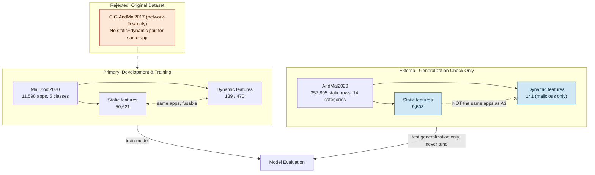

# 01 — Dataset Selection & Problem Statement

**Legend:** `CONFIRMED` = directly verified from our files · `RESEARCH-BACKED` = from the official dataset paper/docs · `PROPOSED` = our design choice · `OPEN` = not yet tested.

## 1. What Problem Are We Solving?

Classify Android apps into malware categories (not just "malware or not") using two kinds of evidence:
- **Static evidence** — what the app *declares* it can do (permissions, intents, APIs, from the manifest).
- **Dynamic evidence** — what the app *actually does* when run (system calls, API behavior, memory activity).

We also want to know if a model trained on one dataset still works on a **different**, independently collected dataset — this tells us whether it learned real malware patterns or just quirks of one data source.

## 2. What Ma'am Originally Gave Us, and What Was Wrong With It — `CONFIRMED`

The brief specifies **CIC-AndMal2017**. What we actually had access to was network-flow (PCAP) data only — 2,141 traffic-capture files, giving features like flow duration, packet counts, and IP/port info.

**The problem:** this is only *one* kind of evidence (network behavior). It has no manifest-based static features (permissions/intents) and no syscall-based dynamic features. Our project needs both, for the same apps, to do the static+dynamic comparison our five model groups depend on. Network-flow data alone can't provide that.

## 3. Why We Switched Datasets

We needed a dataset with **real static features** (permissions/intents/APIs) **and real dynamic features** (system-call/behavioral) **for the same apps** — plus a second, independent dataset to test generalization. That led us to:

- **MalDroid2020** — primary development/training dataset
- **AndMal2020** — external validation dataset

## 4. Why MalDroid2020 — `CONFIRMED` + `RESEARCH-BACKED`

| Reason | Evidence |
|---|---|
| Same apps have both static AND dynamic features | Verified: static file and both dynamic files describe the same 11,598 apps |
| Manageable size for 5 different model types | 11,598 apps — QDA/NuSVC can realistically run on this; they cannot easily run on hundreds of thousands of rows |
| Matches official published dataset exactly | Our class counts (1253/2100/3904/2546/1795) match the official Mahdavifar et al. (2020, IEEE DASC) paper exactly |
| Manageable imbalance | Largest class is only 3.1× the smallest — workable without extreme rebalancing |

## 5. Why AndMal2020 — `CONFIRMED` + `PROPOSED reasoning`

**Not simply "it's bigger."** The real reason: AndMal2020 was collected completely independently — different apps, different labeling process (VirusTotal antivirus consensus vs. MalDroid's own categorization), different scale, different category system. Testing our MalDroid-trained model on AndMal2020 tells us whether it learned genuine malware signal or just memorized quirks of the MalDroid collection process. That is the actual purpose of "external validation" — not just using a bigger pile of data.

Supporting facts:
- 357,805 static app records locally available, across 14 malware categories + benign — `CONFIRMED`
- Officially: 400,000 apps, 191 malware families, labeled via VirusTotal (≥70% AV engine agreement) — `RESEARCH-BACKED`

## 6. Dataset Relationship Diagram

## 7. Summary Table

| | Original Dataset | MalDroid2020 | AndMal2020 |
|---|---|---|---|
| Static features | ❌ Not available | ✅ 50,621 | ✅ 9,503 |
| Dynamic features | Network-flow only | ✅ 139 / 470 (syscall) | ✅ 141 (memory/API/etc.) |
| Static+dynamic same app? | N/A | ✅ Yes | ❌ No |
| Role | Superseded | Train & develop | External validation only |
