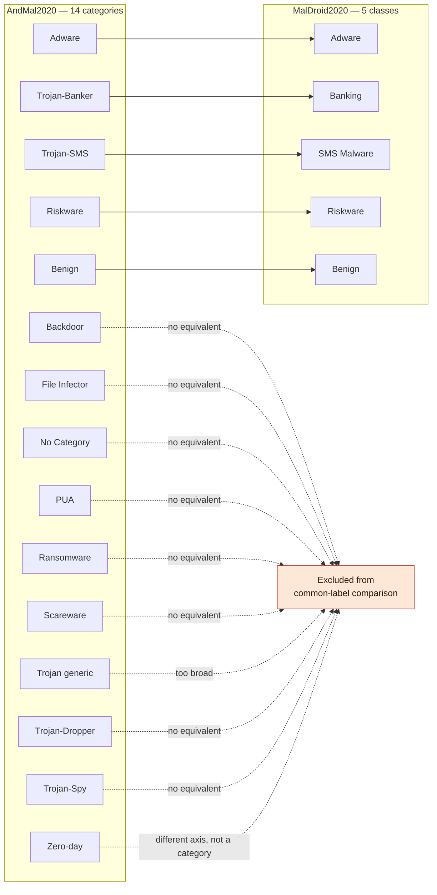

# 03 — Dataset Comparison & Label Mapping

## 1. Side-by-Side Comparison

| | MalDroid2020 | AndMal2020 |
|---|---|---|
| Apps | 11,598 | 357,805 (static) |
| Classes | 5 | 14 + benign |
| Static features | 50,621 | 9,503 |
| Dynamic features | 139 / 470 | 141 |
| Static+dynamic same apps? | ✅ Yes | ❌ No |
| Imbalance | 3.1× | 145× |
| Sample ID available? | ❌ No hash column anywhere | ✅ Hash in every file |
| Labeling method | Dataset authors' categorization | VirusTotal, ≥70% AV consensus |
| Role | Train & develop | External validation |

## 2. MalDroid's 5 Classes (Our Training Taxonomy)

```
Benign · Adware · Banking · SMS Malware · Riskware
```

## 3. AndMal2020's 14 Categories — What Maps, What Doesn't



**We do not force-fit unrelated categories.** Backdoor, Ransomware, Scareware, etc. have no MalDroid equivalent and are excluded from the main comparison rather than mislabeled.

## 4. What This Means in Practice — `CONFIRMED`

Only 5 of AndMal2020's 14 categories participate in the common-label validation:

| AndMal category | Local filename | Row count |
|---|---|---|
| Adware | `Adware.csv` | 47,210 |
| Trojan-Banker | `Banker.csv` | 887 |
| Trojan-SMS | `SMS.csv` | 3,125 |
| Riskware | `Riskware.csv` | 97,349 |
| Benign | `Ben0–Ben4.csv` | 162,181 |

**Roughly 47,000 of AndMal's ~195,000 malicious rows are used** — the rest (~148,000, categories like Ransomware, Trojan, Zeroday, etc.) are outside this comparison's scope. This must be stated plainly whenever "AndMal external validation" results are shown, so the scope isn't overstated.

**Naming note:** AndMal's static files use short names (`Banker`, `SMS`) while the official category names and the dynamic files use full names (`Trojan-Banker`, `Trojan-SMS`). A simple name-matching step handles this — flagged here so it isn't missed during implementation.

## 5. Optional Second Check — `PROPOSED`

Alongside the 5-class comparison above, we can additionally run a simple **binary check** (benign vs. any-malware) using AndMal2020's *entire* dataset — this sidesteps the category-mismatch problem entirely and uses all the data. Recommended as a bonus experiment, not a replacement.
