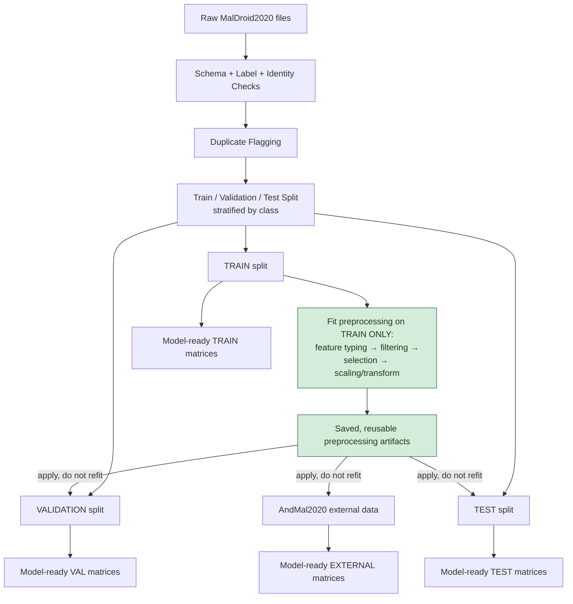
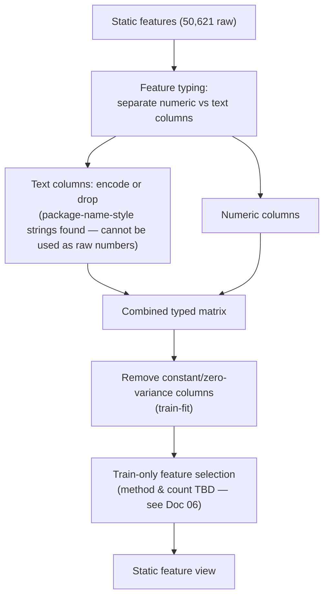
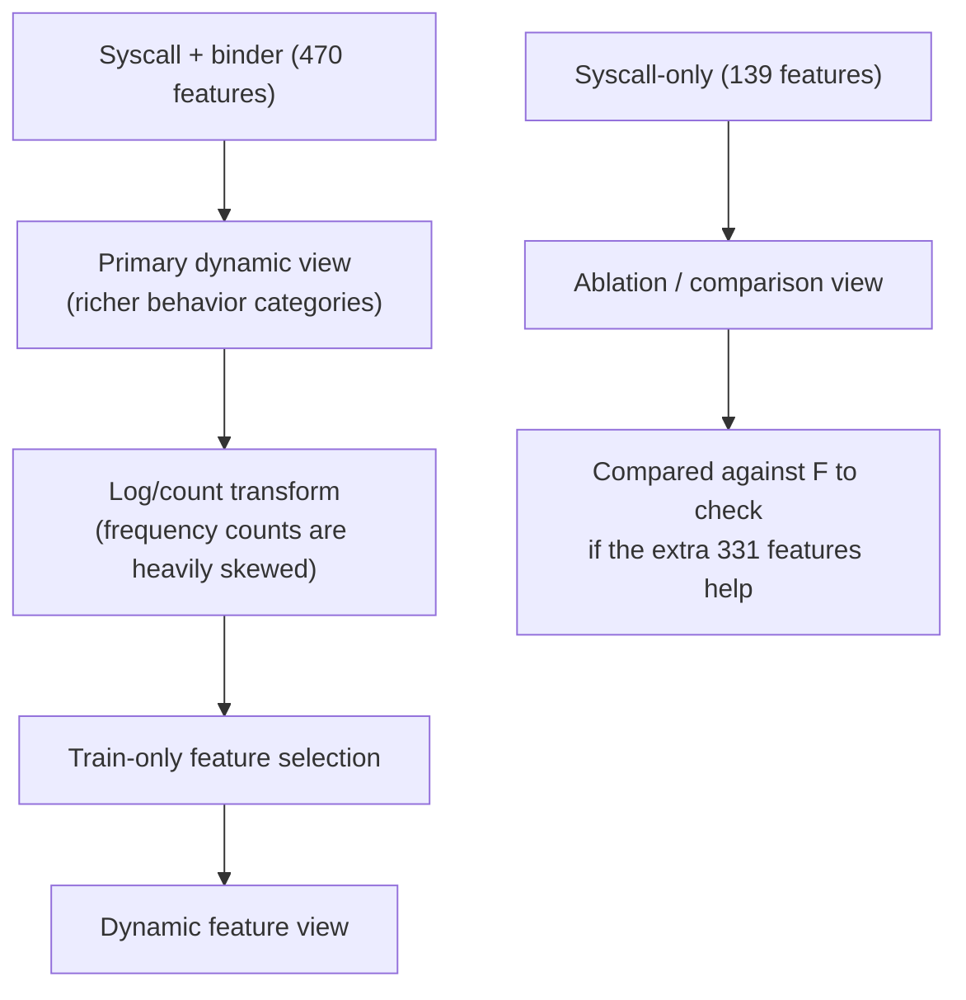
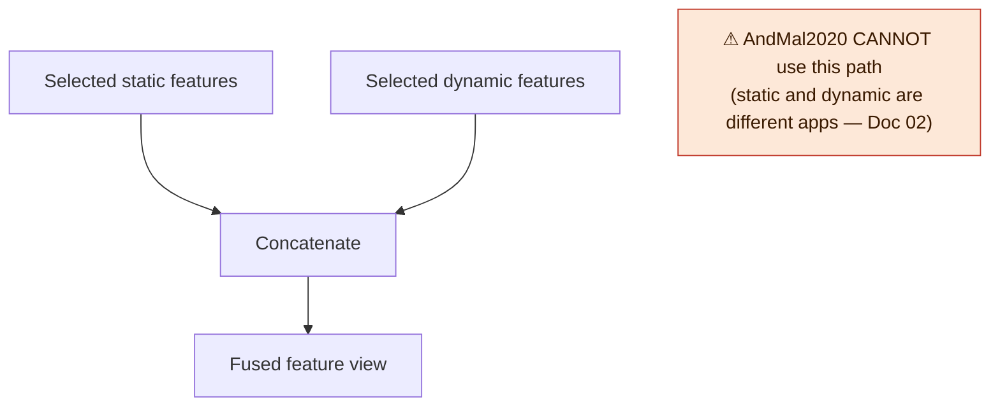

# 04 — Proposed Data Preprocessing Pipeline

Everything in this document is `PROPOSED` — none of it is implemented yet.

## 1. Step-by-Step, With the "Why" for Each

| Step | What it does | Why it exists |
|---|---|---|
| 1. Keep raw data untouched | Original files never edited in place | So every fix is traceable and reversible |
| 2. Schema check | Confirm expected column counts/types | Catches a broken file immediately instead of silently propagating errors |
| 3. Label check | Confirm every row has a valid class | Prevents training on mislabeled/unlabeled rows |
| 4. Identity check | Record sample hash where available (AndMal) | Needed for leakage-safe splitting (Doc 07) |
| 5. Duplicate flagging | Mark exact/near-duplicate rows found in Doc 02 | So duplicates are grouped correctly at split time, not scattered across train/test |
| 6. Train/val/test split | Split by class, grouped by identity where possible | Keeps evaluation honest — no sample "seen twice" |
| 7. Fit preprocessing on TRAIN ONLY | Scaling, feature selection, transforms are calculated using train data only | **This is the single most important rule.** If we calculate anything using validation/test/AndMal data, we leak information about the data we're supposed to be "testing blind" on — the results would look better than they really are. |
| 8. Apply to val/test/AndMal | Use the train-fitted parameters, never re-fit | Keeps the evaluation honest and reproducible |

## 2. Detailed Preprocessing Flow

## 3. Static Branch

**Why this matters:** we directly hit a real error trying to treat every static column as a number — some are genuine text (like package names). Skipping this typing step would crash the pipeline.

## 4. Dynamic Branch

**Why two dynamic views:** the 470-feature set is a superset of the 139-feature set (same syscalls, plus binder/behavior categories). Running both tells us whether the extra features actually improve results, rather than just assuming "more is better."

## 5. Static + Dynamic Fusion (MalDroid2020 only)

**Why we test static-only, dynamic-only, AND fused, instead of just fusing everything:**
- If we only ever test the fused version, we can't tell whether static or dynamic features are actually doing the work.
- Some models (QDA especially) may do *worse* with more features if sample size per class is small — fusion isn't automatically better.
- Comparing all four views (static-only, syscall-only, syscall+binder-only, fused) is how we find out what's actually true for this data, instead of assuming it.

---

## 6. Where This Fits in the Full System

This document covers **pipeline steps 1–12** of the complete 18-step system. Everything from step 13 onward — model-specific feature views, training, internal evaluation, external AndMal evaluation, explainability, and the final report — is described in the documents below.

| What this doc covers | Full-system steps |
|---|---|
| Raw data → schema/label/identity checks → duplicate audit → taxonomy mapping | Steps 1–6 |
| Train/val/test split | Step 7 |
| Train-only preprocessing fit (typing → filtering → selection → scaling) | Step 8 |
| Static branch, Dynamic branch, Fusion branch | Steps 9–11 |
| Feature selection benchmarking | Step 12 |
| *(out of scope for this doc)* Model-specific views → training → evaluation → report | Steps 13–18 |

→ **See [07 — Leakage & Reproducibility Protocol](07_Leakage_Reproducibility_Protocol.md)** for the full anti-leakage rules that govern step 8 and the AndMal isolation policy.
