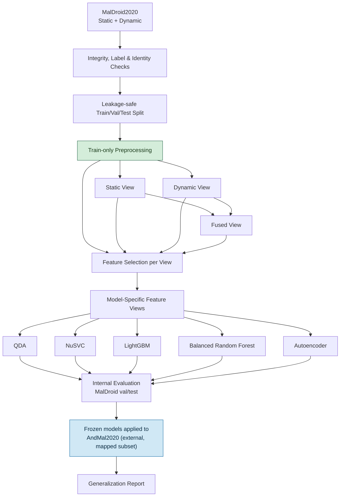
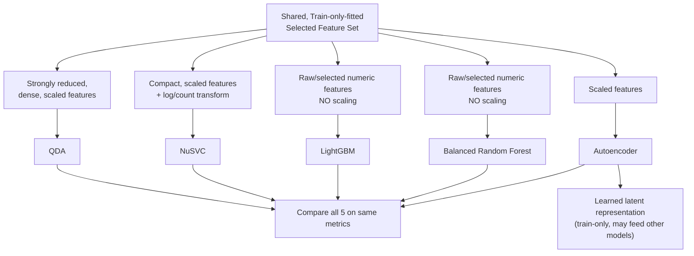

# 05 — Proposed Model Architecture

## 1. Overall End-to-End Architecture

## 2. Why One Shared Matrix Doesn't Work for All 5 Models

Each model has different mathematical needs:

| Model                  | Needs scaling? | Handles many features well?       | Key limitation                                                                                           |
| ---------------------- | -------------- | --------------------------------- | -------------------------------------------------------------------------------------------------------- |
| QDA                    | Yes            | No                                | Needs far more samples-per-class than features, or its internal math (covariance estimation) breaks down |
| NuSVC                  | Yes            | No                                | Kernel methods work best on compact, well-scaled features                                                |
| LightGBM               | No             | Yes                               | Tree splits don't care about feature scale                                                               |
| Balanced Random Forest | No             | Yes                               | Same as above; rebalances classes internally                                                             |
| Autoencoder            | Yes            | Learns its own compressed version | Needs scaled input to learn a meaningful compressed representation                                       |

Giving QDA the same 470-raw-feature matrix that LightGBM is happy with would break QDA's own assumptions (its smallest class, Adware, only has 1,253 samples). Giving LightGBM a heavily-reduced matrix built for QDA would throw away signal trees could have used. **So: one shared foundation, then a model-specific adapter per model.**

## 3. Model-Specific Pipelines

**Nothing here is final.** Exact feature counts for each view, QDA's target dimensionality, and the autoencoder's architecture are all open questions to be settled by experiment (Doc 06), not fixed values.

## 4. Quick Reference — Where Each Algorithm's Design Comes From

- LightGBM: histogram-based tree splitting, doesn't need scaling (Ke et al., NeurIPS 2017).
- Balanced Random Forest: rebalances classes via bootstrap sampling (Chen, Liaw & Breiman, UC Berkeley Tech Report 666, 2004).
- NuSVC: ν parameter controls margin/error trade-off (Schölkopf et al., Neural Computation, 2000).
- QDA: needs samples-per-class ≫ feature count for a stable model (standard statistical learning theory).
- SHAP for explainability: Lundberg & Lee, NeurIPS 2017.
