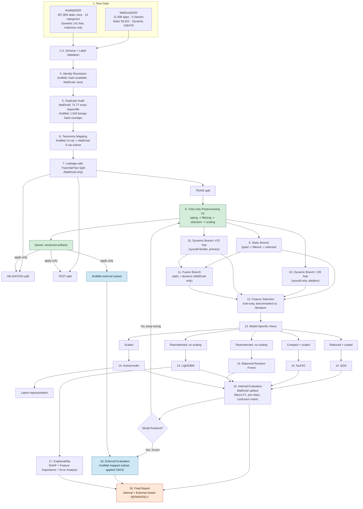

# 05 — Proposed Model Architecture

The single "whole picture" document. Every pipeline step, where each of the 5 algorithms sits, and one end-to-end diagram tying it all together. Pulls together [Doc 04 — Preprocessing](04_Proposed_Data_Preprocessing_Pipeline.md) into one place so the full system can be read without jumping between files.

**Legend:** `CONFIRMED` = directly verified from our files · `RESEARCH-BACKED` = from official dataset paper/docs · `PROPOSED` = our design choice, not yet run · `OPEN` = must be tested, not assumed.

---

## 1. The Pipeline, Step by Step

| # | Stage | What happens to the data | Why this step exists |
|---|---|---|---|
| 1 | **Raw data** | MalDroid2020 (static 50,621 feat + dynamic 139/470 feat, 11,598 apps) and AndMal2020 (static 9,503 feat, dynamic 141 feat, 357,805 rows) sit untouched | Nothing is edited in place — every fix produces a new file, so we can always trace back to the original `CONFIRMED` |
| 2 | **Schema validation** | Check column counts/types match what's expected | Catches a broken file immediately — this is exactly how we caught MalDroid's static file being 6 columns short `CONFIRMED` |
| 3 | **Label validation** | MalDroid: confirm `Class` ∈ {1..5}. AndMal: derive label from filename (no native column) | Prevents training on a row with no real label |
| 4 | **Identity resolution** | AndMal: record hash. MalDroid: no hash exists anywhere — row index is the only identity | Needed to prevent the same sample appearing in both train and test |
| 5 | **Duplicate audit** | Flag MalDroid's 72–77 exact-duplicate rows/file; flag AndMal's 1,503 hash-overlapping benign rows | So duplicates are grouped correctly at split time, not scattered `CONFIRMED` |
| 6 | **Taxonomy mapping** | Map AndMal's 14 categories → MalDroid's 5 (only 5 map cleanly — Doc 03) | AndMal can only be compared to MalDroid on categories that actually correspond |
| 7 | **Train / Validation / Test split** | MalDroid split 3 ways, stratified by class, duplicate rows kept together | Validation tunes the model; test gives one honest final number; AndMal is separate from all three |
| 8 | **Train-only preprocessing fit** | Feature typing → filtering → selection → scaling — calculated using the TRAIN split only | If we calculate this using val/test/AndMal data, we leak information and the results become fake-optimistic `PROPOSED, critical rule` |
| 9 | **Static branch** | 50,621 raw static features → typed (numeric vs. text) → filtered → selected | Static file mixes real numbers with text (e.g. package names) — must be typed before selection or it crashes |
| 10 | **Dynamic branch** | 139-feature and 470-feature views both processed, in parallel | Tests whether the extra 331 binder/behavior features actually help, instead of assuming so |
| 11 | **Fusion branch** | Selected static + selected dynamic concatenated (MalDroid only) | AndMal can't do this — its static and dynamic files are different, non-overlapping apps `CONFIRMED` |
| 12 | **Feature selection** | Train-only ranking; candidate counts benchmarked against literature (80-feature ReliefF, 270-feature LightGBM importance) | Reduces dimensionality to something each model can actually handle |
| 13 | **Model-specific views** | Same selected features reshaped per model (scaled+reduced for QDA, scaled for NuSVC/Autoencoder, raw for LightGBM/BRF) | One matrix doesn't fit all 5 models' math (§2 below) |
| 14 | **Model training** | QDA, NuSVC, LightGBM, Balanced RF, Autoencoder each trained on their own view | See §2 |
| 15 | **Internal evaluation** | MalDroid held-out val/test — Macro-F1, per-class metrics, confusion matrix | Honest, in-distribution performance check |
| 16 | **External evaluation** | Frozen model applied once to AndMal's mapped subset | Tests generalization to an independently collected dataset — the actual point of using AndMal at all |
| 17 | **Explainability** | SHAP + LightGBM feature importance + manual error review | So results aren't just "94% accuracy, trust us" |
| 18 | **Report** | Internal and external results shown separately, never averaged | Combining them would hide whether the model actually generalizes |

---

## 2. Where Each Algorithm Sits, and Why

| Model | Sits at pipeline step | Input it receives | Why this input, not the shared raw matrix |
|---|---|---|---|
| **QDA** | 13→14, static/dynamic/fused view | Strongly reduced, dense, **scaled** features | QDA estimates a covariance matrix per class. MalDroid's smallest class (Adware) has only 1,253 samples — feeding it hundreds of raw features would make that covariance estimate unstable `RESEARCH-BACKED — standard statistical learning theory` |
| **NuSVC** | 13→14, static/dynamic/fused view | Compact, **scaled**, count-transformed features | Kernel methods are sensitive to feature scale and don't handle very high dimensionality well `RESEARCH-BACKED — Schölkopf et al., Neural Computation, 2000` |
| **LightGBM** | 13→14, static/dynamic/fused view | Raw/selected numeric features, **no scaling** | Tree-based splits are scale-invariant; LightGBM's histogram method is built to handle thousands of features efficiently `RESEARCH-BACKED — Ke et al., NeurIPS 2017`. This is Group 3's own primary model. |
| **Balanced Random Forest** | 13→14, static/dynamic/fused view | Raw/selected numeric features, **no scaling** | Rebalances classes internally via bootstrap sampling, so it doesn't need external class-weighting `RESEARCH-BACKED — Chen, Liaw & Breiman, UC Berkeley Tech Report 666, 2004` |
| **Autoencoder** | 13→14, static/dynamic/fused view | **Scaled** input | Learns its own compressed (latent) representation via reconstruction error — needs scaled input for that to be meaningful. Its latent output can optionally feed other models `PROPOSED` |

All five are evaluated on the same internal MalDroid metrics (step 15) and the same external AndMal metrics (step 16), so results are directly comparable across algorithms.

---

## 3. Complete End-to-End Architecture Diagram

---

## 4. Reading the Diagram

- **Green boxes** = the train-only-fitting rule in action — this is the one step that, if done wrong, invalidates every downstream number.
- **Blue boxes** = anything touching AndMal2020 — always downstream of a frozen model, never feeding back into training.
- **Orange box** = the final report, which deliberately keeps internal and external results separate rather than blending them into one number.
- Steps 9–12 run once per branch (static, dynamic-139, dynamic-470, fused) — four parallel passes through the same logic, not four different pipelines.
- Steps 13–14 run once per model per branch — the diagram shows one pass for readability; in practice this is a grid of (4 branches) × (5 models) = 20 training runs per experiment configuration.

---

## 4a. Plain-English Walkthrough — The Full System in Simple Words

### Phase 1 — Start with raw data (Steps 1–6)
We have two datasets sitting on disk: **MalDroid2020** (11,598 Android apps, each with both static and dynamic features) and **AndMal2020** (357,805 apps, static features only, collected independently). Neither file is touched directly — every operation produces a new output file so we can always go back.

Before anything else, we run a set of sanity checks. We verify that each file has the right number of columns and the right data types (schema check), confirm that every row has a valid class label (label check), and record a unique identity for each sample where one exists — AndMal2020 has a SHA hash per app, MalDroid2020 has none. We also flag any exact duplicate rows so they don't accidentally end up split across training and testing.

Finally, we map AndMal2020's 14 malware categories down to the 5 categories that MalDroid2020 uses. Nine of AndMal's categories have no MalDroid equivalent and are excluded from the main comparison.

**Input:** two raw CSV datasets. **Output:** cleaned, labelled, identity-resolved, duplicate-flagged datasets ready to split.

---

### Phase 2 — Split the data honestly (Step 7)
MalDroid2020 is split into three non-overlapping sets: **Train** (used to build the model), **Validation** (used to tune it), and **Test** (used for the final in-distribution score). Duplicate rows are always kept together so the same app never appears in two different sets. AndMal2020 is kept completely separate — it is never part of this split.

**Input:** full MalDroid2020 dataset. **Output:** Train / Validation / Test sets.

---

### Phase 3 — Learn how to process data, using only the training set (Step 8)
This is the most critical step. We look at the **training set only** and use it to decide things like: which columns are numeric vs. text, which columns have zero variance (useless), how to scale the numbers, and which features to keep. These decisions are saved as reusable artefacts.

The reason we use only the training set here is simple: if we used the validation or test data to make these decisions, we'd be secretly peeking at the answers before the exam — the results would look better than they really are. So we learn *how* to process data from train, then apply those same rules blindly to validation, test, and AndMal2020.

**Input:** training set. **Output:** fitted preprocessing artefacts (scaler, feature selector, etc.) saved to disk.

---

### Phase 4 — Build the feature branches (Steps 9–12)
Using the preprocessing artefacts from Phase 3, we transform all four datasets (train, val, test, AndMal) through three parallel branches:

- **Static branch** — 50,621 raw columns → text columns separated out → constant columns removed → top features selected → compact numeric matrix.
- **Dynamic branch (two versions)** — the 139-feature syscall-only set and the 470-feature syscall+binder set are both processed independently. Running both lets us check whether the extra 331 binder features actually improve accuracy, rather than assuming they do.
- **Fusion branch** — the selected static features and selected dynamic features are concatenated into one combined matrix. This is only possible for MalDroid2020, because AndMal2020's static and dynamic files describe completely different apps.

At the end of this phase, each branch has a clean, model-ready feature matrix for every split.

**Input:** raw feature columns. **Output:** four feature matrices (static, dynamic-139, dynamic-470, fused) for each of train / val / test / AndMal.

---

### Phase 5 — Adapt features for each model, then train (Steps 13–14)
Each of the 5 models needs a slightly different version of the feature matrix:

- **QDA** gets a strongly reduced, scaled matrix — it breaks down mathematically if given too many features relative to the number of samples per class.
- **NuSVC** gets a compact, scaled matrix — kernel methods are sensitive to feature scale and high dimensionality.
- **LightGBM** gets the raw selected features with *no* scaling — tree-based models don't care about scale and handle thousands of features fine.
- **Balanced Random Forest** gets the same raw selected features — it also handles imbalance internally through bootstrap sampling.
- **Autoencoder** gets a scaled matrix — it learns a compressed internal representation (called a latent space), and scaling is needed for that compression to be meaningful.

Each model is trained on its adapted training matrix. This gives us 5 trained models per feature branch, so 20 trained models in total across all 4 branches.

**Input:** branch feature matrices. **Output:** 20 trained models.

---

### Phase 6 — Evaluate internally (Step 15)
Each trained model is evaluated on the MalDroid2020 validation and test sets — data it has never seen, but from the same original source it was trained on. This gives us an honest in-distribution score: how well does the model do on MalDroid apps?

Metrics reported: Macro-F1 (primary), per-class Precision/Recall/F1, Balanced Accuracy, and Confusion Matrices. Accuracy alone is not used as the headline because MalDroid2020 is imbalanced.

If the results aren't good enough, hyperparameters are adjusted and we go back to training — but *only using train and validation data*, never touching the test set.

**Input:** trained models + val/test matrices. **Output:** internal performance scores.

---

### Phase 7 — Evaluate externally, exactly once (Step 16)
Once a model is completely finalised (no more tuning), it is applied to the **AndMal2020 mapped subset** — the ~310,000 rows from AndMal's 5 matching categories. This happens exactly once per model, after everything else is locked. No re-tuning, no re-fitting, no parameter changes.

This step answers the real question: does a model trained on MalDroid2020 still work on apps it has never seen, collected by a completely different research group using a different labeling method?

**Input:** frozen trained models + AndMal2020 matrices. **Output:** external generalization scores.

---

### Phase 8 — Explain and report (Steps 17–18)
For LightGBM specifically, SHAP values and feature importance scores are computed to show *which* features drove each prediction. Misclassified samples are also reviewed manually so results aren't just a number without meaning.

The final report shows internal results and external results **side by side, never combined into a single average**. Blending them would hide whether the model actually generalizes or just performs well on its home dataset.

**Output:** internal scores, external scores, feature importance rankings, and SHAP explanations — reported separately.

## 5. What's Confirmed vs. Still Open

`CONFIRMED`: all dataset numbers, the static-file corruption/repair, the AndMal duplicate findings, the taxonomy mapping gaps, the model-specific input requirements (scaling/dimensionality).

`OPEN — requires experiment` (Doc 06 has the full list): exact feature-selection method/count per branch, QDA's target dimensionality, autoencoder architecture/latent size, whether the optional full-dataset binary AndMal check is run alongside the 5-class comparison.

---

## 6. Related Documents

| Document | What it adds beyond this doc |
|---|---|
| [01 — Dataset Selection & Problem Statement](01_Dataset_Selection_and_Problem_Statement.md) | Why MalDroid2020 + AndMal2020 were chosen; original dataset problem |
| [02 — Deep Dataset Forensic Findings](02_Deep_Dataset_Forensic_Findings.md) | Verified row counts, duplicate details, header/column issues |
| [03 — Dataset Comparison & Label Mapping](03_Dataset_Comparison_and_Label_Mapping.md) | Full 14→5 category mapping diagram; excluded categories explained |
| [04 — Proposed Data Preprocessing Pipeline](04_Proposed_Data_Preprocessing_Pipeline.md) | Deep-dive into steps 1–12: static branch, dynamic branch, fusion branch with separate diagrams |
| [06 — Experimental & Evaluation Plan](06_Experimental_and_Evaluation_Plan.md) | 4 feature experiments × 5 models grid; metrics; literature benchmarks |
| [07 — Leakage & Reproducibility Protocol](07_Leakage_Reproducibility_Protocol.md) | Full anti-leakage rules, seed policy, artifact versioning |
| [08 — Limitations & Open Questions](08_Limitations_and_Open_Questions.md) | Confirmed gaps and assumptions that cannot be resolved with current data |
| [09 — Professor Approval Summary](09_Professor_Approval_Summary.md) | One-page summary + open questions for supervisor |
