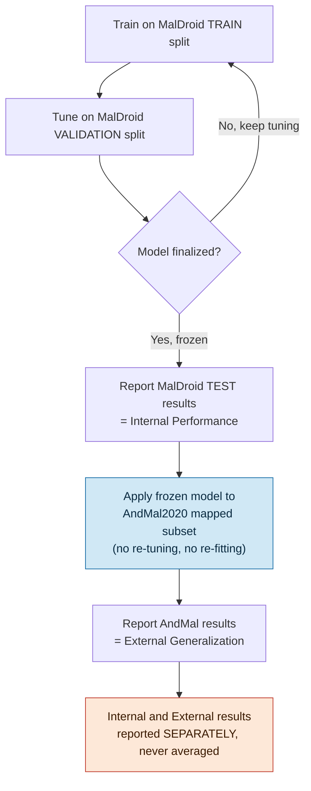

# 06 — Experimental & Evaluation Plan

## 1. What We Will Test

| Experiment | Input |
|---|---|
| A — Static only | 50,621 raw → selected subset |
| B — Dynamic (syscall only) | 139 raw → selected subset |
| C — Dynamic (syscall + binder) | 470 raw → selected subset |
| D — Static + Dynamic fusion | Selected A + selected C combined |

Each of the 5 models (QDA, NuSVC, LightGBM, Balanced RF, Autoencoder) is run against every experiment it can realistically handle (Doc 05 §2).

## 2. Feature Selection — Starting Points From Published Work `RESEARCH-BACKED`

Two results from prior published work on this exact dataset, found during our literature check (exact paper titles still to be pinned down before final citation):
- **80 features via ReliefF** → 97.5% precision (Random Forest)
- **270 features via LightGBM importance** (42.6% reduction from 470) → 96.5% accuracy, 95.7% F1

These are **reference points to compare against**, not values we're adopting blindly — our own selection experiment must be run and reported alongside them.

## 3. Metrics

Because both datasets are imbalanced (3.1× MalDroid, up to 145× AndMal), **accuracy alone is not the headline metric.**

- Macro-F1 (primary)
- Weighted-F1, Balanced Accuracy
- Per-class Precision/Recall/F1
- Confusion Matrix
- ROC-AUC / PR-AUC (one-vs-rest)

## 4. Explainability

- LightGBM feature importance
- SHAP values
- Manual review of misclassified samples

## 5. Internal Evaluation → External Validation Flow

**Key rule:** AndMal2020 is touched exactly once per finalized model — after all tuning is done. This is what makes it a genuine generalization test rather than just more training data.

## 6. What's Still Open

- Final feature-selection method/counts (our own results not yet produced)
- QDA's target dimensionality
- Autoencoder architecture/latent size
- Whether to also run the optional full-dataset binary AndMal check (Doc 03 §5)
