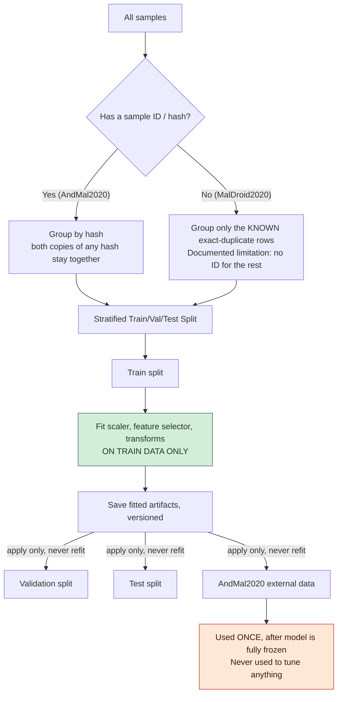

# 07 — Leakage & Reproducibility Protocol

## 1. Why This Document Exists

The whole point of AndMal2020 is to answer "does this model generalize?" If we accidentally let information from the test/external data leak into training, the answer becomes meaningless — we'd just be measuring how well the model memorized data it already saw.

## 2. The Two Leakage Risks in Our Specific Data

1. **AndMal2020 has 1,503 rows that share a hash with another row** (Doc 02). If one copy lands in "train" and the other in "test," the model gets an unfair sneak peek. **Fix: group by hash — both copies of any hash always go into the same split.**
2. **MalDroid2020 has no hash column at all.** We can only split by class balance, not by identity. We can still group the 72–77 *exact* duplicate rows we found (Doc 02 A.5), but this is a known, documented limit — not a solved problem.

## 3. Leakage Prevention Flow

## 4. Rules, Plainly Stated

| Rule | Meaning |
|---|---|
| Train-only fitting | Scalers, feature selectors, PCA, and the autoencoder itself are only ever *fit* on train data. Val/test/AndMal are only *transformed* using those already-fit parameters. |
| Identity-grouped splitting | Same real-world sample never appears in two different splits (where we have a way to know it's the same sample). |
| AndMal isolation | AndMal2020 is never used to pick features, tune hyperparameters, fit scalers, or choose a winning model. It's used exactly once, after everything else is locked. |
| Fixed seeds | All random operations use recorded seeds so results are reproducible. |
| Versioned artifacts | Every fitted object (scaler, selector, model) is saved with a version tag — never silently overwritten. |
| Experiment logging | Every run's exact configuration (feature view, selection method, hyperparameters, seed) is recorded so any reported number can be traced back and re-run. |

## 5. What We Cannot Do (Honesty Note)

We cannot check whether the *same app* appears in both MalDroid2020 and AndMal2020, because MalDroid2020 has no hash/ID column in any of its files. This is a real, documented gap — not something we're pretending to have solved.
