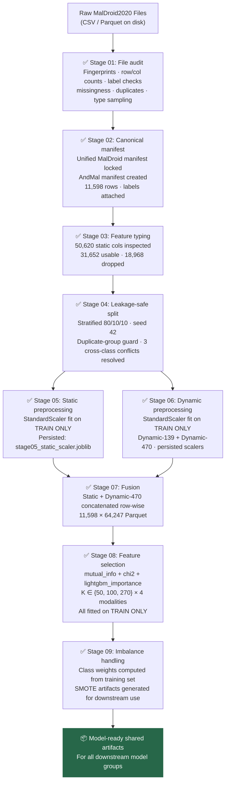
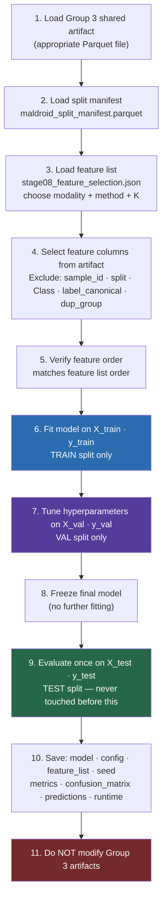
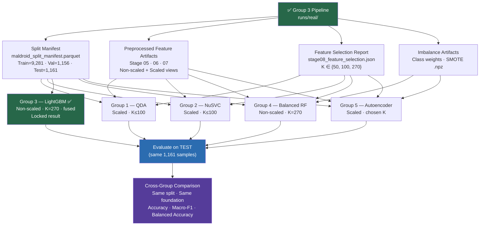

# Model Group Integration Guide
## Android Malware Classification — Group 3 Shared Pipeline

**Document version:** Final (revised — artifact-verified)  
**Audience:** Groups 1 (QDA), 2 (NuSVC), 4 (Balanced RF), 5 (Autoencoder)  
**Source:** `runs/real/` — completed Group 3 execution  
**All artifact dimensions, column counts, and metrics verified against actual files**

---

## Section 0 — How to Access Group 3 Artifacts

All shareable artifacts are committed **directly to this repository** under `runs/real/`. No separate download server is needed.

### Clone workflow

```bash
git clone <repository-url>
cd App-Malware-CNS-Project
git lfs install   # one-time per machine
git lfs pull      # fetch the large LFS-managed artifacts
```

### Storage tiers

| Artifact type | Storage | Available after |
|---|---|---|
| Small artifacts (manifests, JSONs, scalers, small Parquets) | Normal Git | `git clone` |
| Large feature Parquets (79–87 MB) | **Git LFS** | `git lfs pull` |
| Raw datasets (MalDroid2020, AndMal2020) | **External only** | Obtain from dataset authors — see [`Docs/DATASET_SETUP.md`](../Docs/DATASET_SETUP.md) |

### Files in Git LFS (require `git lfs pull`)

| File | Size | Notes |
|---|---|---|
| `runs/real/artifacts/stage05_static_features.parquet` | 79 MB | Full static features (11,598 × 63,306) |
| `runs/real/artifacts/stage05_static_scaler.joblib` | 6 MB | Static StandardScaler |
| `runs/real/artifacts/stage07_fused_features.parquet` | 87 MB | Fused features (11,598 × 64,247) |
| `runs/real/manifests/andmal_manifest.parquet` | 15 MB | AndMal manifest |
| `Docs/Android_Malware_Project_Full_Documentation.docx` | 0.9 MB | Binary documentation |

> **Note:** LFS pointer files look like small text files (~130 bytes) until you run `git lfs pull`. If you load a Parquet and get a `ParquetInvalidFileError`, you are reading a pointer — run `git lfs pull` first.

For a complete data and artifact reference, see **[Docs/GITHUB_DATA_AND_ARTIFACTS.md](../Docs/GITHUB_DATA_AND_ARTIFACTS.md)**.

---

## Section 1 — Purpose

Group 3 has built and executed the **complete shared data pipeline** for this project. Every model group works from the **same shared data foundation**:

- **Same canonical dataset** (MalDroid2020, 11,598 samples)
- **Same canonical labels** (deterministic integer → class mapping)
- **Same train/validation/test split** (seed 42, stratified, leakage-safe)
- **Same leakage protections** (all preprocessing fitted on training data only)
- **Same validated preprocessing foundation** (persisted scaler artifacts)
- **Model-specific representation after the shared pipeline** (each group chooses the appropriate view for their model family)

Model comparisons are only scientifically valid when all groups evaluate on the **same held-out test split**. Building your own split or your own scaler independently breaks this guarantee.

> ⚠️ **"Same shared foundation" ≠ "identical representation."**  
> LightGBM and tree-based models do not require standard scaling. QDA, NuSVC, and Autoencoder may require scaled representations. Group 3 provides both — each group chooses the appropriate view for their model family.

---

## Section 2 — What Group 3Has Already Done



**You do not repeat any of these steps.** Load the artifacts directly.

---

## Section 3 — What Artifacts Are Available

All paths are **repository-relative** from the project root. Never hardcode machine-specific paths.

### 3.1 Split Manifest

| Artifact | Path | Columns | Rows |
|---|---|---|---|
| Split manifest | `runs/real/manifests/maldroid_split_manifest.parquet` | `sample_id`, `label_canonical`, `dup_group`, `split` | 11,598 |

- `sample_id` — row identifier
- `label_canonical` — integer class label (1–5)
- `dup_group` — duplicate group assignment (NaN if not a duplicate)
- `split` — `'train'` / `'val'` / `'test'`

> ⚠️ The manifest does **not** contain a `Class` string column. Class names are: 1=Adware, 2=Banking, 3=SMS Malware, 4=Riskware, 5=Benign.

### 3.2 Static Features Artifact

| Artifact | Path | Physical Dimensions | Contents |
|---|---|---|---|
| Static preprocessed | `runs/real/artifacts/stage05_static_features.parquet` | **11,598 × 63,306** | See breakdown below |
| Static scaler | `runs/real/artifacts/stage05_static_scaler.joblib` | — | Fitted StandardScaler for new data |

**Column breakdown (63,306 total):**

| Column group | Count | Description |
|---|:---:|---|
| Metadata: `sample_id` | 1 | Row identity — **never use as feature** |
| Metadata: `split` | 1 | Split assignment — **never use as feature** |
| **Processed non-scaled feature view** | **31,652** | Original static feature values after typing/cleaning |
| **Processed scaled feature view** | **31,652** | Same features after `StandardScaler` (train-only fit) |
| **Total** | **63,306** | |

> **No `Class` or `label` column in this artifact.** Labels come from the split manifest.

### 3.3 Dynamic Features Artifacts

#### Dynamic-139 (syscall frequency only)

| Artifact | Path | Physical Dimensions | Contents |
|---|---|---|---|
| Dynamic-139 preprocessed | `runs/real/artifacts/stage06_dynamic_139_features.parquet` | **11,598 × 281** | See below |
| Dynamic-139 scaler | `runs/real/artifacts/stage06_dynamic_139_scaler.joblib` | — | Fitted StandardScaler |

**Column breakdown (281 total):** `sample_id` + `split` + `Class` (3 meta) + 139 processed non-scaled + 139 processed scaled = 281

#### Dynamic-470 (syscall + Binder/composite)

| Artifact | Path | Physical Dimensions | Contents |
|---|---|---|---|
| Dynamic-470 preprocessed | `runs/real/artifacts/stage06_dynamic_470_features.parquet` | **11,598 × 943** | See below |
| Dynamic-470 scaler | `runs/real/artifacts/stage06_dynamic_470_scaler.joblib` | — | Fitted StandardScaler |

**Column breakdown (943 total):** `sample_id` + `split` + `Class` (3 meta) + 470 processed non-scaled + 470 processed scaled = 943

> `Class` in dynamic artifacts is the string class name (e.g., `"Adware"`). Use `label_canonical` from the manifest for integer labels.

### 3.4 Fused Feature Artifact

| Artifact | Path | Physical Dimensions | Contents |
|---|---|---|---|
| Fused | `runs/real/artifacts/stage07_fused_features.parquet` | **11,598 × 64,247** | See below |

**Column breakdown (64,247 total):**

| Column group | Count | Prefix | Description |
|---|:---:|---|---|
| Metadata: `sample_id` | 1 | — | **Never use as feature** |
| Metadata: `split` | 1 | — | **Never use as feature** |
| Metadata: `Class` | 1 | — | String label — **never use as feature** |
| Static non-scaled features | 31,652 | `static__` | Processed static feature values |
| Dynamic-470 non-scaled features | 470 | `dyn470__` | Processed dynamic feature values |
| Static scaled features | 31,652 | `static__...__scaled` | StandardScaler-transformed static |
| Dynamic-470 scaled features | 470 | `dyn470__...__scaled` | StandardScaler-transformed dynamic |
| **Total** | **64,247** | | |

> **Logical feature count: 32,122 unique features** (31,652 static + 470 dynamic-470), each present in both non-scaled and scaled form.

### 3.5 Feature Selection Report

| Artifact | Path | Contents |
|---|---|---|
| Selection report | `runs/real/artifacts/stage08_feature_selection.json` | Feature lists for all modalities, methods, and K values |

**Exact JSON structure (verified):**

```
{
  "static":       { "n_raw_features": 31652, "methods": { "mutual_info": { "50": [...], "100": [...], "270": [...] }, "chi2": {...}, "lightgbm_importance": {...} } },
  "dynamic_139":  { "n_raw_features": 139,   "methods": { ... } },
  "dynamic_470":  { "n_raw_features": 470,   "methods": { ... } },
  "fused":        { "n_raw_features": 32122, "methods": { ... } }
}
```

**Available K values: `50`, `100`, `270` only.** There is no K=60 in this artifact.

> If your model requires a different K (e.g., K=30), this is **model group responsibility**: take the top-K entries from the ranked list for an existing K (`50` or `100`), using only training-set-derived rankings. Do **not** derive a new ranking from the test set.

### 3.6 Imbalance Artifacts

| Artifact | Path | Contents |
|---|---|---|
| Imbalance report | `runs/real/artifacts/stage09_imbalance_report.json` | Class weights + split distributions |
| SMOTE dynamic-139 | `runs/real/artifacts/stage09_smote_dynamic_139.npz` | SMOTE-resampled `X` + `y` for dynamic-139 training split |
| SMOTE dynamic-470 | `runs/real/artifacts/stage09_smote_dynamic_470.npz` | SMOTE-resampled `X` + `y` for dynamic-470 training split |

### 3.7 Group 3 Locked Model (reference — do not modify)

| Artifact | Path | Contents |
|---|---|---|
| Frozen LightGBM | `runs/real/artifacts/stage14_frozen_model.joblib` | Trained LightGBM · 270-feature fused contract |
| Lock manifest | `runs/real/artifacts/stage14_lock_manifest.json` | Feature names · verified metrics · config |

---

## Section 4 — Shared Split Contract

**All model groups must use this exact split. Do NOT create a new random split from the raw dataset.**

| Split | Samples |
|---|:---:|
| **Train** | **9,281** |
| **Validation** | **1,156** |
| **Test** | **1,161** |
| Total | 11,598 |

**Source:** `runs/real/manifests/maldroid_split_manifest.parquet` → `split` column  
**Seed:** 42 · **Strategy:** Stratified by label · **Verified from:** `runs/real/status.json` → `stage04_split.artifacts.split_counts`

> Creating your own train/test split from the raw dataset will produce different sample assignments, making cross-group comparison invalid.

---

## Section 5 — Feature Contract and Metadata Exclusion

### DO NOT CONFUSE

> **Raw dataset files** (original CSV/Parquet on disk, immutable)  
> ≠ **Processed artifact** (cleaned, typed, output of pipeline stages)  
> ≠ **Scaled representation** (StandardScaler-transformed view within the artifact)  
> ≠ **Selected model feature list** (the K columns chosen by Stage 08 feature selection)  
> ≠ **Model-specific learned representation** (e.g., autoencoder latent space — Group 5's responsibility)

### Metadata columns — NEVER include in X

| Column | Type | Present in | Role | Include in X? |
|---|---|---|---|---|
| `sample_id` | int | All artifacts | Row identity | ❌ Never |
| `split` | str | All artifacts | Split assignment | ❌ Never |
| `Class` | str | Dynamic + Fused artifacts | String class name | ❌ Never |
| `label_canonical` | int | Manifest | Ground-truth label | ❌ in X — ✅ as `y` |
| `dup_group` | int/NaN | Manifest | Duplicate group | ❌ Never |

### Feature columns

Feature columns are everything **except** the metadata columns listed above.

Rules:
- Use only the columns in the agreed feature list from `stage08_feature_selection.json`
- Preserve exact feature order (as returned by the JSON list)
- Do not add extra columns
- Do not remove columns from the agreed feature list
- Do not silently zero-fill missing values

---

## Section 6 — Artifact Selection Rule

Use this decision table to choose which artifact to load for your model:

| Modality | Artifact to load | Feature list key | Logical feature count |
|---|---|---|---|
| **Static only** | `stage05_static_features.parquet` | `sel["static"]["methods"][method][K]` | 31,652 (before selection) |
| **Dynamic-139 only** | `stage06_dynamic_139_features.parquet` | `sel["dynamic_139"]["methods"][method][K]` | 139 (before selection) |
| **Dynamic-470 only** | `stage06_dynamic_470_features.parquet` | `sel["dynamic_470"]["methods"][method][K]` | 470 (before selection) |
| **Fused** | `stage07_fused_features.parquet` | `sel["fused"]["methods"][method][K]` | 32,122 (before selection) |

**Always use the corresponding feature list to select columns from the artifact. Do not use all columns from the artifact.**

---

## Section 7 — Raw vs Scaled Representation

Each artifact stores both a processed non-scaled view and a processed scaled view of the same logical features. Choose based on your model:

| Model | Recommended representation | Reason |
|---|---|---|
| **LightGBM** (Group 3) | Processed non-scaled features | Tree models are scale-invariant |
| **Balanced RF** (Group 4) | Processed non-scaled features | Tree models are scale-invariant |
| **QDA** (Group 1) | Processed scaled features | QDA assumes Gaussian distributions; scale matters |
| **NuSVC** (Group 2) | Processed scaled features | SVM kernels are sensitive to feature scale |
| **Autoencoder** (Group 5) | Processed scaled features | Neural networks train more stably on normalized inputs |

**In the static artifact** (`stage05`): non-scaled columns have plain names (e.g., `/system/bin/sh`); scaled columns end in `__scaled` (e.g., `/system/bin/sh__scaled`).

**In the fused artifact** (`stage07`): non-scaled static columns have prefix `static__`; scaled static columns have prefix `static__` and suffix `__scaled`; similarly for `dyn470__` prefix columns.

> **The feature selection lists** (`stage08_feature_selection.json`) reference the non-scaled column names by convention. When using scaled columns, append `__scaled` to the selected column names as appropriate for your artifact, or use the `stage05`/`stage06` artifacts directly (which contain both views under a single naming scheme).

---

## Section 8 — Group 1: QDA

**Model:** Quadratic Discriminant Analysis

**Group 3 provides:**
- Shared split manifest
- Processed scaled static features (`stage05_static_features.parquet` — scaled columns)
- Processed scaled dynamic features (`stage06_dynamic_139_features.parquet` — scaled columns)
- Feature selection lists for K ∈ {50, 100, 270}

**Group 1's responsibility:**
- Select an appropriate K from the available values (50, 100, or 270), or derive a smaller subset from the top-K ranked list, fitted on training data only
- Apply any additional dimensionality reduction (e.g., PCA) **fitted on training data only** — QDA is numerically unstable with high-dimensional inputs
- Fit QDA model on `X_train`, `y_train`
- Tune `reg_param` using validation set **only**
- Evaluate final frozen model once on TEST
- Save model, config, feature list, seed, metrics

> ⚠️ Do not feed 31,652-dimensional features into QDA without dimensionality reduction. QDA requires the number of features to be substantially smaller than the number of training samples. Use K=50 or K=100 at most, and consider PCA on top if needed.

---

## Section 9 — Group 2: NuSVC

**Model:** Nu-Support Vector Classifier

**Group 3 provides:**
- Shared split manifest
- Processed scaled feature representations (static + dynamic)
- Feature selection lists for K ∈ {50, 100, 270}

**Group 2's responsibility:**
- Select an appropriate compact scaled feature subset (K=50 or K=100 recommended for SVM tractability)
- Fit NuSVC on `X_train`, `y_train`
- Tune `nu`, kernel, and any kernel parameters using validation set **only**
- Evaluate final frozen model once on TEST
- Save model, config, feature list, seed, metrics

> ⚠️ SVM training time scales as O(n²–n³) with sample count. With 9,281 training samples, K=270 may be tractable but K=50–100 will be faster. Do not tune on TEST.

---

## Section 10 — Group 3: LightGBM

Group 3 owns the LightGBM implementation. **Implementation is complete and locked.**

| Item | Value |
|---|---|
| Final model | `runs/real/artifacts/stage14_frozen_model.joblib` |
| Model SHA-256 prefix | `ab63ed065259b79e` |
| Modality | fused (static + dynamic-470) |
| Selected features | 270 (152 static + 118 dynamic-470) |
| Feature contract | `runs/real/artifacts/stage14_lock_manifest.json` → `feature_columns` |
| Test Accuracy | **0.9819121447028424** |
| Test Macro-F1 | **0.9794806809300622** |
| Test Weighted-F1 | 0.9819083668084967 |
| Test Balanced Accuracy | 0.9809595702907510 |

Full per-class metrics, confusion matrix, modality comparison, and configuration details:  
→ [`Docs/final/02_GROUP3_LIGHTGBM_RESULTS.md`](../Docs/final/02_GROUP3_LIGHTGBM_RESULTS.md)

---

## Section 11 — Group 4: Balanced Random Forest

**Model:** Balanced Random Forest (imbalanced-learn `BalancedRandomForestClassifier`)

**Group 3 provides:**
- Shared split manifest
- Processed non-scaled feature representations (static + dynamic — tree models do not need scaling)
- Feature selection lists for K ∈ {50, 100, 270}
- Class weights from `stage09_imbalance_report.json` (if Group 4 prefers weight-based balancing)
- SMOTE-resampled training data `stage09_smote_dynamic_470.npz` (if Group 4 prefers resampling)

**Group 4's responsibility:**
- Select appropriate modality and K value
- Fit `BalancedRandomForestClassifier` on `X_train`, `y_train` (built-in per-tree undersampling handles imbalance)
- Tune `n_estimators`, `max_depth`, etc. using validation set **only**
- Evaluate final frozen model once on TEST
- Save model, config, feature list, seed, metrics

> `BalancedRandomForestClassifier` handles class imbalance internally via random under-sampling per tree. Group 3's class weights and SMOTE artifacts are provided as alternatives if Group 4 prefers a different strategy — this is Group 4's decision.

---

## Section 12 — Group 5: Autoencoder

**Model:** Autoencoder (anomaly/representation learning style)

**Group 3 provides:**
- Shared split manifest
- Processed scaled feature representations (neural networks benefit from normalized inputs)
- Feature selection lists for K ∈ {50, 100, 270}

**Group 5's responsibility:**

> ⚠️ **Critical:** The autoencoder encoder is itself a learned transformation. It must be trained and evaluated with the same leakage constraints as any other model.

1. Load processed scaled selected features
2. Separate into `X_train`, `X_val`, `X_test` using the shared split manifest
3. Train the autoencoder encoder-decoder **on `X_train` only**
4. Tune architecture, epochs, learning rate using `X_val` reconstruction or classification loss
5. Freeze the trained encoder
6. Transform `X_train`, `X_val`, `X_test` using the **frozen encoder** → latent representations
7. Train a downstream classifier on the latent `X_train`
8. Evaluate on latent `X_test`
9. **Never train the autoencoder on the full dataset (train+val+test combined) before splitting**

---

## Section 13 — Standard Model Group Workflow



---

## Section 14 — How to Load the Data

All paths use `pathlib.Path`. The `PROJECT_ROOT` variable must point to the repository root — set it via configuration or by walking up from your script's location (adjust `parents[N]` to match your script's actual depth in the repo).

```python
from pathlib import Path
import json
import numpy as np
import pyarrow.parquet as pq
import logging

log = logging.getLogger(__name__)

# --- Set project root ---
# Adjust parents[N] to match the depth of your script relative to the repo root.
# Example: if your script is at src/models/qda/train.py  →  parents[3]
PROJECT_ROOT = Path(__file__).resolve().parents[3]  # adjust depth as needed

RUNS_REAL = PROJECT_ROOT / "runs" / "real"
ARTIFACTS = RUNS_REAL / "artifacts"
MANIFESTS = RUNS_REAL / "manifests"

# -----------------------------------------------------------------------
# 1. Load split manifest
# -----------------------------------------------------------------------
mf_path = MANIFESTS / "maldroid_split_manifest.parquet"
mf_table = pq.read_table(mf_path, columns=["sample_id", "label_canonical", "split"])
mf_df    = mf_table.to_pandas().set_index("sample_id")

train_idx = mf_df[mf_df["split"] == "train"].index
val_idx   = mf_df[mf_df["split"] == "val"].index
test_idx  = mf_df[mf_df["split"] == "test"].index

y_train = mf_df.loc[train_idx, "label_canonical"].values
y_val   = mf_df.loc[val_idx,   "label_canonical"].values
y_test  = mf_df.loc[test_idx,  "label_canonical"].values

assert len(train_idx) == 9281,  f"Train count mismatch: {len(train_idx)}"
assert len(val_idx)   == 1156,  f"Val count mismatch:   {len(val_idx)}"
assert len(test_idx)  == 1161,  f"Test count mismatch:  {len(test_idx)}"

# -----------------------------------------------------------------------
# 2. Load feature selection list
# -----------------------------------------------------------------------
sel = json.loads((ARTIFACTS / "stage08_feature_selection.json").read_text(encoding="utf-8"))

# Choose your modality, method, and K. Available K: '50', '100', '270'.
# Available methods: 'mutual_info', 'chi2', 'lightgbm_importance'
MODALITY = "fused"           # or 'static', 'dynamic_139', 'dynamic_470'
METHOD   = "lightgbm_importance"
K        = "270"

feat_cols = sel[MODALITY]["methods"][METHOD][K]   # ordered list of column names
assert len(feat_cols) == int(K), f"Feature list length mismatch: {len(feat_cols)}"

# Guard: none of the selected features should be metadata
METADATA_COLS = {"sample_id", "split", "Class", "label_canonical", "dup_group", "label"}
leaked = set(feat_cols) & METADATA_COLS
assert not leaked, f"Metadata leaked into feature list: {leaked}"

# -----------------------------------------------------------------------
# 3. Load the artifact matching your modality
# -----------------------------------------------------------------------
# Choose the artifact file that matches MODALITY (see Section 11 selection table)
artifact_map = {
    "static":      ARTIFACTS / "stage05_static_features.parquet",
    "dynamic_139": ARTIFACTS / "stage06_dynamic_139_features.parquet",
    "dynamic_470": ARTIFACTS / "stage06_dynamic_470_features.parquet",
    "fused":       ARTIFACTS / "stage07_fused_features.parquet",
}
artifact_path = artifact_map[MODALITY]

# Read only the needed columns (metadata for index + selected features)
# For scaled features (QDA / NuSVC / Autoencoder), append '__scaled' to feat_cols
# e.g.:  feat_cols_scaled = [c + "__scaled" for c in feat_cols]
# Then:  columns_to_read = ["sample_id"] + feat_cols_scaled

columns_to_read = ["sample_id"] + feat_cols  # non-scaled (tree models)
tbl = pq.read_table(artifact_path, columns=columns_to_read)
df  = tbl.to_pandas().set_index("sample_id")

# -----------------------------------------------------------------------
# 4. Align feature matrix with split index and construct splits
# -----------------------------------------------------------------------
X = df[feat_cols]   # shape: (11598, K) — preserves feat_cols order

X_train = X.loc[train_idx].values
X_val   = X.loc[val_idx].values
X_test  = X.loc[test_idx].values

# -----------------------------------------------------------------------
# 5. Sanity checks
# -----------------------------------------------------------------------
assert X_train.shape == (9281, int(K)),  f"X_train shape: {X_train.shape}"
assert X_val.shape   == (1156, int(K)),  f"X_val shape:   {X_val.shape}"
assert X_test.shape  == (1161, int(K)),  f"X_test shape:  {X_test.shape}"
assert not np.any(np.isnan(X_train)), "NaN values in X_train"

log.info("Data loaded: X_train=%s  X_val=%s  X_test=%s", X_train.shape, X_val.shape, X_test.shape)
```

### Loading class weights

```python
imb = json.loads((ARTIFACTS / "stage09_imbalance_report.json").read_text(encoding="utf-8"))
# Structure: imb[modality]["class_weights"] → {class_name: weight}
cw_named = imb[MODALITY]["class_weights"]

# Convert to sklearn-compatible {int_label: weight}
LABEL_MAP = {"Adware": 1, "Banking": 2, "SMS Malware": 3, "Riskware": 4, "Benign": 5}
cw_dict   = {LABEL_MAP[k]: v for k, v in cw_named.items()}
```

### Loading SMOTE data

```python
smote       = np.load(ARTIFACTS / "stage09_smote_dynamic_470.npz")
X_train_aug = smote["X"]   # resampled training features
y_train_aug = smote["y"]   # resampled labels
```

---

## Section 15 — Data Leakage Rules

### ✅ Allowed

- Train model (fit weights) on `X_train`, `y_train`
- Tune hyperparameters using `X_val`, `y_val` metrics
- Evaluate final frozen model **once** on `X_test`, `y_test`
- Use Group 3's pre-fitted scaler artifacts for transform-only operations on new data
- Use Group 3's pre-selected feature lists as-is

### ❌ Not Allowed

- Fit any scaler, selector, encoder, or model on validation or test data
- Use test-set metrics to select hyperparameters
- Create an independent train/test split from the raw dataset
- Re-fit Group 3's preprocessing on AndMal2020
- Modify any file under `runs/real/artifacts/` or `runs/real/manifests/`
- Train an autoencoder (or any model) on the full 11,598-sample dataset before splitting
- Include `Class`, `split`, `sample_id`, `label_canonical`, or `dup_group` as model input features
- Zero-fill missing feature values to match a different dataset's feature names

---

## Section 16 — AndMal2020 Usage

AndMal2020 is designated for **external generalization analysis only** — not a second training pool.

**Correct use pattern:**
- After your model is fully frozen on MalDroid data, attempt to evaluate it on the appropriate AndMal subset
- Use the frozen MalDroid preprocessing contract (do not refit on AndMal)
- Report the result accurately — including when evaluation is not feasible

**Known limitation for the Group 3 locked fused LightGBM model:**

The locked model requires 270 specific feature names, of which 118 are `dyn470__` syscall/Binder event names. AndMal2020's dynamic features (144 columns) use memory/API/battery/logcat measurements — a completely different instrumentation framework. **0 of the 270 required feature names exist in AndMal's dynamic feature representation.**

This limitation applies to the **current locked fused MalDroid model under the current feature contract**. It does not imply:
- That cross-dataset evaluation is impossible for all experiments
- That a static-only model could not be evaluated on AndMal's static features (subject to static feature-name overlap)
- That future models designed with cross-dataset compatibility in mind would face the same limitation

**Zero-filling missing columns was rejected:** treating "not measured by this instrumentation" as "measured and zero" changes the model's input semantics without data support, and produces scores that are artifacts of the fill strategy, not measures of generalization.

---

## Section 17 — Outputs Expected from Each Group

Save all of the following for consistent project-level comparison:

| Output | Format | Notes |
|---|---|---|
| Trained model | `.joblib` or `.pt` | Serialized, reproducible |
| Config | `.json` or `.yaml` | All hyperparameters + seed |
| Feature list used | `.json` | Ordered list of exact column names |
| Random seed | In config | Must be recorded |
| Train metrics | `.json` | Accuracy · Macro-F1 · Weighted-F1 · Balanced Accuracy |
| Validation metrics | `.json` | Same metrics |
| **Test metrics** | **`.json`** | **Authoritative result — same 4 metrics** |
| Per-class Precision/Recall/F1 | `.json` | Nested by class name |
| Confusion matrix | `.json` + `.png` | Row=true, Col=predicted |
| Predictions on test set | `.npy` or `.csv` | `sample_id` + predicted label |
| Training runtime | In metrics `.json` | Seconds |

---

## Section 18 — Troubleshooting

| Symptom | Likely Cause | Resolution |
|---|---|---|
| `KeyError: 'column_name'` | Column not in artifact | Verify selected K, method, and modality match the artifact |
| Shape `(9280, ...)` instead of `(9281, ...)` | Wrong index or split filter | Filter manifest by `split == 'train'` before indexing |
| Model predicts only one class | Metadata leaked into X or label mismatch | Assert `METADATA_COLS & set(feat_cols) == set()` |
| `ValueError: X has N features, expected M` | Feature order mismatch or wrong K | Reload feature list from JSON; use `df[feat_cols]` not `df.iloc[:, :]` |
| Test accuracy > 99.9% | `Class` or `label_canonical` in X | Check column exclusion guard |
| QDA: singular matrix | Too many features | Use K=50; add PCA fitted on TRAIN only |
| NuSVC: convergence warning | Features not scaled | Use scaled artifact columns (suffix `__scaled`) |
| Autoencoder loss not converging | Features not normalized | Verify scaled artifact view is used |
| AndMal evaluation fails | Feature-space incompatibility | Expected for locked fused model — see Section 16 |
| `FileNotFoundError` | Wrong project root depth | Adjust `parents[N]` in `PROJECT_ROOT` |
| SMOTE shape unexpected | Wrong `.npz` key | Use `smote["X"]` and `smote["y"]` |
| `OSError: Repetition level histogram size mismatch` | PyArrow version incompatibility reading manifest | Read artifact files with the project's installed PyArrow version; manifest may need `iter_batches` fallback |

---

## Section 19 — Model Group Responsibility Matrix

| Group | Model | Group 3 Provides | Model Group Decides / Implements | Shared Split |
|---|---|---|---|---|
| **1** | QDA | Split manifest · Scaled feature artifacts · Feature lists (K=50,100,270) | QDA-specific dimensionality reduction (fitted on TRAIN only) · `reg_param` tuning · Final evaluation | ✅ Yes |
| **2** | NuSVC | Split manifest · Scaled feature artifacts · Feature lists (K=50,100,270) | Nu/kernel hyperparameter tuning (VAL only) · Final evaluation | ✅ Yes |
| **3** | LightGBM | **Complete pipeline + frozen locked model** | **Done ✅** | ✅ Yes |
| **4** | Balanced RF | Split manifest · Non-scaled feature artifacts · Feature lists (K=50,100,270) · Class weights · SMOTE artifacts | Balancing strategy choice · Hyperparameter tuning (VAL only) · Final evaluation | ✅ Yes |
| **5** | Autoencoder | Split manifest · Scaled feature artifacts · Feature lists (K=50,100,270) | Encoder architecture + training (TRAIN only) · Latent representation · Downstream classifier · Final evaluation | ✅ Yes |

---

## Section 20 — Integration Diagram



---

## Section 21 — Final Verification Checklist

Before submitting your model group's results:

- [ ] Split counts match: Train=9,281 · Val=1,156 · Test=1,161
- [ ] `sample_id`, `split`, `Class`, `label_canonical`, `dup_group` are **not** in your feature matrix X
- [ ] All preprocessing you added (scaler, encoder, PCA) was fitted **on training data only**
- [ ] Hyperparameter tuning used **validation set only**
- [ ] Test set was evaluated **exactly once** at the end
- [ ] Feature names match the agreed list from `stage08_feature_selection.json`
- [ ] Feature order is preserved from the shared artifact
- [ ] Model artifact saved with config and seed recorded
- [ ] All four metrics reported: Accuracy, Macro-F1, Weighted-F1, Balanced Accuracy
- [ ] Per-class Precision / Recall / F1 and confusion matrix saved
- [ ] No Group 3 artifact was modified
- [ ] K value used is one of `50`, `100`, or `270` (or a subset derived from those ranked lists on TRAIN only)
- [ ] If K=60 or similar is needed: derived from top-60 entries of K=100 or K=270 list without test leakage
- [ ] AndMal usage (if any) documented accurately — no zero-filling of missing features
- [ ] No independent re-split of the raw dataset was performed

---

*All artifact dimensions, column structures, feature selection key hierarchies, split counts, and LightGBM metrics in this document were verified against the actual files in `runs/real/` before publication. No values were estimated or assumed.*
