# Final Shared Data Pipeline
## Android Malware Classification — Group 3

**Document version:** Final (post-execution)  
**Run source:** `runs/real/`  
**Date of run:** 2026-09-26 to 2026-09-27

---

## 6.1 Project Objective

Group 3 designed, implemented, and owns the **complete shared data pipeline** for a five-class Android malware classification system. The pipeline ingests raw heterogeneous datasets, performs rigorous data auditing and integrity checking, constructs a leakage-safe train/validation/test split, applies train-only preprocessing, engineers static and dynamic feature branches, performs multi-method feature selection, and delivers model-ready feature contracts to downstream classifiers.

Group 3's own classifier is **LightGBM**. The pipeline architecture was additionally designed to support multiple model families (QDA, NuSVC, Balanced Random Forest, Autoencoder) for other downstream groups — those are **not** attributed to Group 3.

---

## 6.2 Dataset Architecture

### Primary Development Dataset — MalDroid2020

```
MalDroid2020  (11,598 samples, 5 classes)
├── Static
│   └── feature_vectors_static_repaired.parquet
│       50,620 total columns (label attached via row-order alignment)
├── Dynamic — syscall frequency (139 features)
│   └── feature_vectors_syscalls_frequency_5_Cat.csv
└── Dynamic — syscall + Binder/composite (470 features)
    └── feature_vectors_syscallsbinders_frequency_5_Cat.csv
```

**Class distribution:**

| Integer Label | Class Name  | Count  |
|:---:|:---|:---:|
| 1 | Adware      | 1,253 |
| 2 | Banking     | 2,100 |
| 3 | SMS Malware | 3,904 |
| 4 | Riskware    | 2,546 |
| 5 | Benign      | 1,795 |
| **Total** | | **11,598** |

### External Validation Dataset — AndMal2020

```
AndMal2020  (357,805 static rows; 53,439 dynamic rows — malicious only)
├── Static/Benign/     Ben0–Ben4   (9,503 feature columns per file)
├── Static/Malicious/  Adware, Banker, Riskware, SMS, ...
└── Dynamic/BeforeAndAfterReboot/  144 columns per file
```

**AndMal → 5-class label mapping:**

| AndMal Category | Mapped Label |
|---|---|
| Adware | Adware |
| Banker | Banking |
| SMS | SMS Malware |
| Riskware | Riskware |
| Ben0–Ben4 | Benign |

Rows mappable to 5-class taxonomy: **310,752** (of 357,805 total).

> **Dataset roles:**  
> MalDroid2020 = primary development, training, validation, and internal test evaluation.  
> AndMal2020 = external validation / domain-shift analysis **only**.  
> AndMal was **not** used to tune the MalDroid model. MalDroid preprocessing was **not** refit on AndMal.

---

## 6.3 Complete End-to-End Pipeline

```mermaid
flowchart TD
    A["🗂️ Raw Data\nMalDroid static CSV + dynamic CSVs + AndMal files"]

    A --> S01["Stage 01 — File Audit\n361.7 s\nFingerprinting · row/col counts · label validation\nmissingness · duplicate detection · type sampling"]
    S01 --> S02["Stage 02 — Canonical Manifest\n28.5 s\nMalDroid manifest 11,598 rows\nAndMal manifest 357,805 rows · labels attached"]
    S02 --> S03["Stage 03 — Feature Typing\n125.2 s\n50,620 static columns inspected\n31,652 usable · 18,968 dropped"]
    S03 --> S04["Stage 04 — Leakage-Safe Split\n1.3 s\nStratified 80/10/10 · seed 42\n77 duplicate rows grouped · 3 cross-class conflicts resolved"]

    S04 --> S05["Stage 05 — Static Preprocessing\n175.3 s\nStandardScaler fit on TRAIN ONLY\nOutput: 11,598 × 31,652 Parquet"]
    S04 --> S06["Stage 06 — Dynamic Preprocessing\n1.6 s\nStandardScaler fit on TRAIN ONLY\nDynamic-139 · Dynamic-470"]

    S05 --> S07["Stage 07 — Fusion\n168.4 s\nStatic + Dynamic-470 concatenated row-wise\nOutput: 11,598 × 64,247 Parquet"]
    S06 --> S07

    S07 --> S08["Stage 08 — Feature Selection\n2,464.7 s\nmutual_info · chi2 · lightgbm_importance\nK ∈ {50, 100, 270} × 4 modalities · TRAIN-ONLY fit"]
    S08 --> S09["Stage 09 — Imbalance Analysis\n288.8 s\nClass weights computed from train distribution\nSMOTE generated for downstream groups"]

    S09 --> S11["Stage 11 — LightGBM Training\n5.5 s\ndynamic_470 modality · initial selection run\nn_estimators=300 · lr=0.05 · CPU"]
    S11 --> S12["Stage 12 — Internal Evaluation\n0.3 s\nTEST split · dynamic_470 modality\nAccuracy=0.9543 · Macro-F1=0.9457"]
    S12 --> S13["Stage 13 — Modality Ablation\n323.8 s\nRetrain LightGBM on all 4 modalities\nSelect winner by Macro-F1 on TEST split"]
    S13 --> S14["Stage 14 — Model Lock\n247.4 s\nWinner: fused · K=270\nRetrain · verify metrics · serialize frozen model"]
    S14 --> S15["Stage 15 — External Validation\n0.1 s\n0 / 270 feature names matched in AndMal\nValidation not possible — feature-space incompatibility"]
    S15 --> S16["Stage 16 — Report\n1.3 s\nFINAL_REPORT.md · plots generated"]

    style A fill:#2d3748,color:#fff,stroke:#4a5568
    style S04 fill:#2b6cb0,color:#fff,stroke:#2c5282
    style S08 fill:#744210,color:#fff,stroke:#975a16
    style S14 fill:#276749,color:#fff,stroke:#276749
    style S15 fill:#742a2a,color:#fff,stroke:#9b2c2c
```



---

## 6.4 Data Integrity

### MalDroid2020

| Property | Dynamic-139 | Dynamic-470 | Static (repaired) |
|---|:---:|:---:|:---:|
| Rows | 11,598 | 11,598 | 11,598 |
| Feature columns | 139 | 470 | 50,620 |
| Missing values | 0 | 0 | — |
| Zero-variance features | 0 | 0 | 22 |
| Exact duplicate rows | 77 | 72 | — |
| File SHA-256 prefix | `b61652e6` | `a8f3279c` | `fb5ce9ec` |

### AndMal2020 Static Summary

| Category | Rows | Unique Hashes |
|---|:---:|:---:|
| Ben0–Ben4 (Benign) | 162,181 | 162,181 |
| Adware | 47,210 | 47,210 |
| Riskware | 97,349 | 97,349 |
| SMS | 3,125 | 3,125 |
| Banker | 887 | 887 |
| Ransomware | 6,202 | 6,202 |
| Trojan | 13,559 | 13,559 |
| Zeroday | 13,340 | 13,340 |
| Others (Backdoor, Dropper, etc.) | 10,952 | — |
| **Total** | **357,805** | **356,302** |

Cross-file overlaps: Ben0 ∩ Ben1 = 1,502; Ben0 ∩ Ben4 = 1. No cross-category label conflicts.

**AndMal dynamic:** 53,439 rows; 144 columns per file; **malicious categories only** — no benign dynamic file in this release. Before/after reboot files are not row-aligned; joinable only via SHA-256 hash.

---

## 6.5 MalDroid Static Repair

**Issues detected in the raw static CSV:**
- Encoding/header mismatch requiring UTF-7 decode
- No independent per-sample SHA-256 hash or APK identifier in the released file
- Class column requires external attachment

**Repair approach:**
1. UTF-7 decode + column header realignment
2. Class label attached via **row-order alignment** with the dynamic feature file (same 11,598-sample population in identical row order)

**Empirical validation:** Row counts match exactly (11,598); per-class distributions are identical between static and both dynamic files.

**Limitation:** Row-order alignment is empirically validated but is **not** cryptographic proof. The static file carries no per-row hash, so hash-based verification is not possible. This limitation is recorded in the audit provenance.

> Provenance string: *"repaired from feature_vectors_static.csv (UTF-7 decode + header realignment + Class attached via ROW-ORDER alignment with the dynamic file — NOT a hash-based join; MalDroid static files carry no sample hash)"*

Repaired artifact: `Dataset/MalDroid2020/Static/feature_vectors_static_repaired.parquet` (SHA-256 prefix: `fb5ce9ec`)

---

## 6.6 Feature Typing

Stage 03 inspected all **50,620** columns of the MalDroid static representation.

| Type | Count | Decision |
|---|:---:|:---|
| Binary numeric | 31,317 | **Usable** |
| Count or continuous numeric | 335 | **Usable** |
| All-missing | 18,931 | Dropped |
| Zero-variance numeric | 22 | Dropped |
| High-cardinality string | 4 | Dropped |
| Categorical string | 11 | Dropped |
| Identity / row-index | 1 | Dropped |
| **Usable numeric total** | **31,652** | |
| **Dropped total** | **18,968** | |

See: **Figure 5** (`assets/figures/fig05_feature_type_distribution.png`)

---

## 6.7 Splitting

| Parameter | Value |
|---|---|
| Strategy | Stratified by label |
| Seed | 42 (deterministic) |
| Train fraction | 0.80 |
| Validation fraction | 0.10 |
| Test fraction | 0.10 |

**Final split counts:**

| Split | Total | Adware | Banking | Benign | Riskware | SMS Malware |
|---|:---:|:---:|:---:|:---:|:---:|:---:|
| Train | 9,281 | 1,002 | 1,680 | 1,440 | 2,036 | 3,123 |
| Validation | 1,156 | 125 | 210 | 176 | 255 | 390 |
| Test | 1,161 | 126 | 210 | 179 | 255 | 391 |

**Duplicate-group handling:** 77 rows were exact duplicates in the 470-feature dynamic space, grouped into 3 duplicate groups. Each group was assigned entirely to one split.

**Cross-class duplicate conflicts:**

| Group ID | Classes Present | Resolved to Split |
|---|---|---|
| 5 | Adware, Riskware | train |
| 776 | Adware, Riskware | test |
| 1257 | Banking, SMS Malware, Riskware, Benign | train |

These represent genuine label ambiguity — identical dynamic fingerprints with different ground-truth labels. No cross-split leakage.

Split manifest: `runs/real/manifests/maldroid_split_manifest.parquet`

**Development note:** A bug in duplicate-group assignment was detected and corrected before the final run. The above counts and group assignments reflect the corrected final state.

---

## 6.8 Static Preprocessing

Steps (train-only fitting):

1. Select 31,652 usable numeric columns (Stage 03)
2. `sklearn.preprocessing.StandardScaler` fitted on **training rows only**
3. Scaler applied (transform only) to validation and test rows
4. Artifacts persisted: `stage05_static_scaler.joblib`, `stage05_static_features.parquet`

**Note on raw vs. scaled representation in artifacts:**  
The fused artifact (`stage07_fused_features.parquet`) contains both raw and scaled static columns. LightGBM is a tree-based model and scale-invariant — it uses the raw selected feature view. The scaled view is available for downstream model groups requiring normalized inputs (e.g., NuSVC, Autoencoder). These are **not** two independent information sources.

---

## 6.9 Dynamic Preprocessing

| Property | Dynamic-139 | Dynamic-470 |
|---|---|---|
| Source | `feature_vectors_syscalls_frequency_5_Cat.csv` | `feature_vectors_syscallsbinders_frequency_5_Cat.csv` |
| Features | 139 | 470 |
| Missing values | 0 | 0 |
| Scaler | StandardScaler (train-only fit) | StandardScaler (train-only fit) |
| Scaler artifact | `stage06_dynamic_139_scaler.joblib` | `stage06_dynamic_470_scaler.joblib` |
| Feature artifact | `stage06_dynamic_139_features.parquet` | `stage06_dynamic_470_features.parquet` |

---

## 6.10 Fusion

Static and dynamic-470 preprocessed representations are concatenated row-wise into a single feature matrix per sample.

**Why fusion is valid on MalDroid:** Both the static and dynamic-470 files share the same 11,598-sample population in the same row order (verified empirically: matching row counts and per-class distributions).

**Fusion output:** `stage07_fused_features.parquet` — 11,598 rows × 64,247 columns (87.3 MB).  
- Static contributes 63,304 columns (31,652 raw + 31,652 scaled)  
- Dynamic-470 contributes 940 columns (470 raw + 470 scaled)

Feature selection then reduces this to 270 final columns.

**Measured result:** Fused modality produced the best LightGBM test performance (Macro-F1 = 0.9795, Accuracy = 0.9819). This is a measured experimental outcome, not a theoretical claim.

---

## 6.11 Feature Selection

**Methods evaluated:**

| Method | Description |
|---|---|
| `mutual_info` | Mutual information between each feature and label |
| `chi2` | Chi-squared statistic |
| `lightgbm_importance` | LightGBM split-gain importance scores |

**K values evaluated:** 50, 100, 270  
**Modalities evaluated:** static, dynamic_139, dynamic_470, fused  
All selectors fitted on training data only. Same selected feature set applied to validation/test without refitting.

**Final locked configuration:** modality = fused, K = 270

**Composition of 270 selected features:**

| Origin | Count |
|---|:---:|
| Static (`static__` prefix) | 152 |
| Dynamic-470 (`dyn470__` prefix) | 118 |
| **Total** | **270** |

Full selection report: `runs/real/artifacts/stage08_feature_selection.json`  
Feature contract: `runs/real/artifacts/stage14_lock_manifest.json` → `feature_columns`

---

## 6.12 Imbalance Strategy

**Strategy used:** `class_weight` (inverse-frequency weighting, passed to LightGBM's `class_weight` parameter)

**Class weights (computed from 9,281 training samples):**

| Class | Weight |
|---|:---:|
| Adware | 1.8525 |
| Banking | 1.1049 |
| Benign | 1.2890 |
| Riskware | 0.9117 |
| SMS Malware | 0.5944 |

SMOTE variants were also generated for dynamic modalities (`stage09_smote_dynamic_139.npz`, `stage09_smote_dynamic_470.npz`) for potential use by other model groups. LightGBM used class weighting only — no resampling applied.

See: **Figure 8** (`assets/figures/fig08_class_weights.png`)

---

## 6.13 Leakage Prevention

```
Stage 04:  Split manifest created
           |
Stages 05/06:  Preprocessing fitted on TRAIN rows only
               Scaler artifacts persisted (.joblib)
           |
Stage 08:  Feature selectors fitted on TRAIN rows only
           Selection artifacts persisted (JSON)
           |
Stages 11/13/14:  Model trained on TRAIN rows only
           |
Stages 12/13/14:  Evaluation on TEST rows only
                  (Validation used for config selection only)
           |
Stage 15:  External data transformed using locked feature contract
           (no refitting on external data)
```

**Evidence artifacts:**

| Evidence | Artifact |
|---|---|
| Split manifest | `manifests/maldroid_split_manifest.parquet` |
| Static scaler | `artifacts/stage05_static_scaler.joblib` |
| Dynamic-139 scaler | `artifacts/stage06_dynamic_139_scaler.joblib` |
| Dynamic-470 scaler | `artifacts/stage06_dynamic_470_scaler.joblib` |
| Feature selection report | `artifacts/stage08_feature_selection.json` |
| Lock manifest (feature contract) | `artifacts/stage14_lock_manifest.json` |
| Duplicate conflict report | `reports/stage04_cross_class_duplicate_conflicts.json` |

---

## 6.14 Reproducibility

| Parameter | Value |
|---|---|
| Global seed | 42 |
| Python version | 3.10.20 (Anaconda, MSC v.1942 64-bit) |
| Platform | Windows 10 (10.0.26200) |
| NumPy | 2.0.1 |
| Pandas | 2.3.3 |
| scikit-learn | 1.7.2 |
| LightGBM | 4.7.0 |
| imbalanced-learn | 0.14.2 |
| PyTorch | 2.5.1 |
| SHAP | 0.49.1 |
| PyArrow | 23.0.1 |

**GPU environment:**  
- PyTorch CUDA: available (NVIDIA RTX 4060 Laptop GPU, 8.59 GB VRAM, CUDA 12.1)  
- LightGBM GPU Tree Learner: **not available** (standard CPU wheel)  
- All LightGBM training ran on CPU

**Key artifacts:**
- Config snapshot: `runs/real/config.yaml.snapshot.json`
- Environment: `runs/real/environment.json`
- Stage status: `runs/real/status.json`
- Frozen model SHA-256 prefix: `ab63ed065259b79e`
- Frozen model: `runs/real/artifacts/stage14_frozen_model.joblib`

*All numbers in this document verified against machine-readable JSON/Parquet artifacts before publication.*
