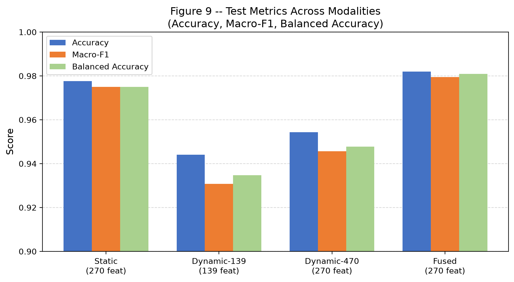

# Group 3 — LightGBM Implementation and Results
## Android Malware Classification

**Document version:** Final (post-execution)  
**Run source:** `runs/real/`  
**Model artifact:** `runs/real/artifacts/stage14_frozen_model.joblib`  
**Model SHA-256 prefix:** `ab63ed065259b79e`

---

## 7.1 Why LightGBM

LightGBM (Light Gradient Boosting Machine) is a gradient boosting framework using histogram-based tree learning. It is well-suited to this problem for the following reasons:

- **High-dimensional sparse binary features:** 31,652 static columns are predominantly binary. Tree-based models handle binary/sparse inputs effectively without normalization.
- **Mixed feature types:** The fused representation combines binary static features with continuous dynamic syscall frequency features. LightGBM handles mixed-type inputs natively.
- **Multi-class classification:** LightGBM supports multi-class softmax natively with class-weight correction for imbalanced datasets.
- **Computational efficiency:** Histogram-based boosting enables fast training on high-dimensional data. The final locked model trained in **11.49 seconds** on CPU.
- **Class imbalance:** The `class_weight` parameter handles imbalanced distributions without resampling.

---

## 7.2 Exact LightGBM Configuration

Extracted from `runs/real/config.yaml.snapshot.json` and `runs/real/artifacts/stage14_lock_manifest.json`:

| Parameter | Value | Notes |
|---|---|---|
| `n_estimators` | 300 | Number of boosting rounds |
| `num_leaves` | 31 | Max leaves per tree |
| `learning_rate` | 0.05 | Shrinkage rate |
| `device_type` | `cpu` | GPU Tree Learner unavailable in installed wheel |
| `class_weight` | Computed | See Table 7.2.1 below |
| `random_state` | 42 | Global reproducibility seed |

All other parameters used LightGBM library defaults (e.g., `max_depth=-1`, `min_child_samples=20`, `subsample=1.0`, `colsample_bytree=1.0`, `reg_alpha=0.0`, `reg_lambda=0.0`).

### Table 7.2.1 — Class Weights Applied

Computed from training set distribution (9,281 samples):

| Class | Training Count | Weight |
|---|:---:|:---:|
| Adware | 1,002 | **1.852495** |
| Banking | 1,680 | **1.104881** |
| Benign | 1,440 | **1.289028** |
| Riskware | 2,036 | **0.911690** |
| SMS Malware | 3,123 | **0.594364** |


---

## 7.3 CPU / GPU Status

| Component | Status |
|---|---|
| PyTorch CUDA | ✅ Available |
| GPU | NVIDIA GeForce RTX 4060 Laptop GPU (8.59 GB VRAM) |
| CUDA Runtime | 12.1 |
| LightGBM GPU Tree Learner | ❌ Not available in installed wheel |
| LightGBM execution | **CPU only** |

The installed wheel (`lightgbm==4.7.0`) is the standard CPU build. The build error was:

```
LightGBMError: GPU Tree Learner was not enabled in this build.
Please recompile with CMake option -DUSE_GPU=1
```

The RTX 4060 GPU and CUDA environment were fully operational for PyTorch. The limitation was specific to the LightGBM wheel. No GPU LightGBM performance claims are made.

---

## 7.4 Final Locked Model

Selected after Stage 13 modality ablation, by maximum Macro-F1 on the TEST split:

| Property | Value |
|---|---|
| Model | LightGBM |
| Modality | **fused** (static + dynamic-470) |
| Feature contract | **270 named columns** |
| Feature list | `stage14_lock_manifest.json` → `feature_columns` |
| Frozen artifact | `runs/real/artifacts/stage14_frozen_model.joblib` |
| SHA-256 prefix | `ab63ed065259b79e` |
| Retrain time | 11.49 seconds (CPU) |
| Stage 13 metrics match | ✅ True (tolerance: 0.01) |

---

## 7.5 Internal Results — All Splits

> ⚠️ **Training, validation, and test metrics are explicitly separated below. Do not conflate them.**

### 7.5.1 Validation Accuracy — Stage 11 (dynamic_470 modality, intermediate)

| Metric | Value | Split | Modality |
|---|---|---|---|
| Accuracy | 0.9584775086505191 | **validation** | dynamic_470 |

This was an intermediate run used to verify Stage 11 training, not the final model selection metric.

### 7.5.2 Final TEST Split Results — Locked Fused Model (Stage 14)

> **Authoritative final results.** Source: `stage14_lock_manifest.json` → `verified_test_metrics`

| Metric | Exact Value |
|---|---|
| **Accuracy** | **0.9819121447028424** |
| **Macro-F1** | **0.9794806809300622** |
| Weighted-F1 | 0.9819083668084967 |
| Balanced Accuracy | 0.9809595702907510 |

### 7.5.3 Per-Class Results — Final Locked Model (TEST split, 1,161 samples)

| Class | Precision | Recall | F1-Score | Support |
|---|:---:|:---:|:---:|:---:|
| Adware | 0.9538461538461539 | 0.9841269841269841 | 0.9687500000000000 | 126 |
| Banking | 0.9806763285024155 | 0.9666666666666667 | 0.9736211031175060 | 210 |
| Benign | 0.9888888888888889 | 0.9944134078212290 | 0.9916434540389972 | 179 |
| Riskware | 0.9723320158102767 | 0.9647058823529412 | 0.9685039370078740 | 255 |
| SMS Malware | 0.9948849104859335 | 0.9948849104859335 | 0.9948849104859335 | 391 |


### 7.5.4 Confusion Matrix — Final Locked Model (TEST split)

Rows = True label · Columns = Predicted label · Order: Adware, Banking, Benign, Riskware, SMS Malware

|  | Adware | Banking | Benign | Riskware | SMS Malware |
|---|:---:|:---:|:---:|:---:|:---:|
| **Adware** | **124** | 0 | 0 | 2 | 0 |
| **Banking** | 2 | **203** | 1 | 4 | 0 |
| **Benign** | 0 | 0 | **178** | 1 | 0 |
| **Riskware** | 4 | 2 | 1 | **246** | 2 |
| **SMS Malware** | 0 | 2 | 0 | 0 | **389** |

✅ Correctly classified: **1,140 / 1,161** · ❌ Misclassified: **21 / 1,161**


---

## 7.6 Split Attribution Summary

| Reported Metric | Split | Stage | Modality | Use |
|---|---|---|---|---|
| Val Accuracy = 0.9585 | **Validation** | Stage 11 | dynamic_470 | Intermediate check |
| Test Accuracy = 0.9543, MF1 = 0.9457 | **TEST** | Stage 12/13 | dynamic_470 | Ablation candidate |
| **Test Accuracy = 0.9819, MF1 = 0.9795** | **TEST** | **Stage 14** | **fused** | ✅ **Final authoritative result** |

---

## 7.7 Modality Comparison

All results on the **TEST split**. Source: `runs/real/metrics/stage13_ablation_results.json`

| Modality | Features | Accuracy | Macro-F1 | Weighted-F1 | Balanced Acc | Train Time |
|---|:---:|:---:|:---:|:---:|:---:|:---:|
| static | 270 | 0.97760551 | 0.97504582 | 0.97772621 | 0.97504310 | 5.581 s |
| dynamic_139 | 139 | 0.94401378 | 0.93076014 | 0.94423824 | 0.93478918 | 3.710 s |
| dynamic_470 | 270 | 0.95434970 | 0.94565578 | 0.95432528 | 0.94777897 | 5.353 s |
| **fused** ⭐ | **270** | **0.98191214** | **0.97948068** | **0.98190837** | **0.98095957** | **6.585 s** |

**Key observations:**
- Fused modality achieves the highest performance on all four metrics
- Static-only outperforms both dynamic-only variants, suggesting static features carry more discriminative signal for this dataset
- Dynamic-139 (smallest feature space) achieves lowest performance
- All modalities trained in under 7 seconds on CPU




---

## 7.8 Selected Feature Analysis

The 270 locked features contain:

| Origin | Count | Percentage |
|---|:---:|:---:|
| Static (`static__` prefix) | 152 | 56.3% |
| Dynamic-470 (`dyn470__` prefix) | 118 | 43.7% |
| **Total** | **270** | |


### Top Selected Feature Categories

**Static features (examples from locked contract):**
- Permission flags: `android.permission.READ_CONTACTS`, `android.permission.WRITE_SETTINGS`, `android.permission.RECORD_AUDIO`
- Intent actions: `android.intent.action.BOOT_COMPLETED`, `android.intent.action.SCREEN_OFF`
- Sensitive API calls: `SmsManager:sendTextMessage`, `TelephonyManager:getSubscriberId`, `TelephonyManager:getSimSerialNumber`
- Numeric metadata: `num_permissions`, `num_services`, `num_libraries`, `num_intent_actions`
- ELF binary indicators: `e_shentsize`, `e_ehsize`, `e_shstrndx`

**Dynamic-470 features (examples from locked contract):**
- Core syscalls: `futex`, `read`, `write`, `mmap2`, `brk`, `ioctl`, `epoll_wait`
- File system patterns: `FS_ACCESS(READ)`, `FS_ACCESS(CREATE__WRITE)`, `FS_ACCESS(WRITE)`
- Network patterns: `NETWORK_ACCESS(WRITE)`, `NETWORK_ACCESS(READ__WRITE)`
- Binder/IPC calls: `getDeviceId`, `getSubscriberId`, `getLine1Number`, `getNetworkInfo`
- Thread/process: `CREATE_THREAD`, `TERMINATE_THREAD`, `getpid`, `gettid`


---

## 7.9 LightGBM Feature Importance

The frozen model (`stage14_frozen_model.joblib`) supports LightGBM's native feature importance via split-gain. Feature importances from the selection phase are recorded in `artifacts/stage08_feature_selection.json` under the `lightgbm_importance` key for each modality and K value.

To extract importance from the frozen model directly:

```python
import joblib
model = joblib.load("runs/real/artifacts/stage14_frozen_model.joblib")
# feature_names_in_ attribute holds the 270 column names
importance = dict(zip(model.feature_names_in_, model.feature_importances_))
```

The top 20 features by selection order are visualized in **Figure 13** above.

---

## 7.10 SHAP Explainability

SHAP 0.49.1 is installed in the execution environment. The frozen model supports `shap.TreeExplainer` without retraining.

SHAP was not invoked during `runs/real` pipeline execution. To generate post-hoc explanations:

```python
import joblib, shap, pandas as pd

model  = joblib.load("runs/real/artifacts/stage14_frozen_model.joblib")
lock   = json.load(open("runs/real/artifacts/stage14_lock_manifest.json"))
feat_cols = lock["feature_columns"]   # 270 column names

# Load fused features and select the 270 columns for test split
# X_test shape: (1161, 270)
explainer   = shap.TreeExplainer(model)
shap_values = explainer.shap_values(X_test)  # shape: (5_classes, 1161, 270)
shap.summary_plot(shap_values[0], X_test, feature_names=feat_cols)
```

> **Important:** SHAP provides **model attribution** — which features the model relied on for a given prediction. SHAP values are **not** causal evidence. They do not prove that a feature causes malicious behavior; they characterize model decision patterns.

---

*All metric values in this document are exact values from `runs/real/artifacts/stage14_lock_manifest.json` and `runs/real/metrics/stage13_ablation_results.json`. No values were rounded, estimated, or substituted.*
