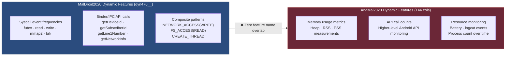

# External Validation — AndMal2020
## Android Malware Classification — Group 3

**Document version:** Final (post-execution)  
**Stage:** Stage 15  
**Source:** `runs/real/metrics/stage15_external_validation.json`

---

## Overview

Stage 15 attempted external validation of the final locked LightGBM model on AndMal2020. The result was that validation was **not possible** due to a feature-space incompatibility. This document describes the exact finding, root cause, and implications — with precision.

---

## The Locked Model's Feature Contract

The final locked model requires exactly **270 named feature columns**, split as:

| Origin | Count |
|---|:---:|
| Static (`static__` prefix) | 152 |
| Dynamic-470 (`dyn470__` prefix) | 118 |
| **Total** | **270** |

Full feature list: `runs/real/artifacts/stage14_lock_manifest.json` → `feature_columns`

---

## Stage 15 Result (Exact)

**`stage15_external_validation.json`:**

```json
{
  "external_validation_possible": false,
  "required_features": 270,
  "matched_by_name_in_andmal": 0,
  "andmal_dynamic_columns_available": 144,
  "reason": "The frozen model requires its exact trained feature columns to be
  present in AndMal2020 by name. MalDroid's dynamic features are syscall/binder
  names (e.g. process/IPC-level events); AndMal2020's dynamic features are
  memory/API/battery/logcat/process-count names — different instrumentation
  entirely. Zero-filling the missing columns was considered and rejected: it
  would silently change what the model is being asked to classify, not perform
  a real evaluation."
}
```

**Finding: 0 of 270 required feature names were found in AndMal's 144 dynamic columns.**

---

## Root Cause: Instrumentation Framework Mismatch



| Dimension | MalDroid Dynamic | AndMal Dynamic |
|---|---|---|
| Instrumentation | Kernel-level syscall/Binder tracing | Resource monitoring (memory, API, battery) |
| Feature type | Event frequency counts (named syscalls) | Resource usage metrics |
| Example features | `futex`, `mmap2`, `getDeviceId` | Heap size, API call counts, logcat entries |
| Feature space size | 470 (syscalls + Binder) | 144 |
| Name overlap with MalDroid | N/A | **0** |

The two datasets were instrumented using completely different dynamic analysis frameworks. The feature names are entirely disjoint.

---

## Why Zero-Filling Was Rejected

It is technically possible to zero-fill the 118 missing `dyn470__` features when applying the model to AndMal data. This was **explicitly rejected** for the following reason:

> Zero-filling treats **"this feature was not measured in this dataset"** as equivalent to **"this feature was measured and its value was zero."**

These two conditions are semantically distinct:
- **Value = 0:** The syscall/Binder event was recorded during instrumentation and occurred zero times.
- **Zero-filled / missing:** The syscall/Binder event was **never measured** — the instrumentation framework does not capture it.

Substituting "not measured" with "measured as zero" changes the model's input distribution in a way that is not supported by the data. Any score produced this way would be an artifact of the fill strategy, not a measure of genuine model generalization. This was rejected as a matter of scientific integrity.

---

## What the Result Means — and Does Not Mean

| Claim | Correct? |
|---|---|
| The locked fused model cannot be directly evaluated on AndMal dynamic data | ✅ Correct |
| Cross-dataset evaluation is impossible in all circumstances | ❌ Incorrect |
| The MalDroid-trained model is a bad model | ❌ Incorrect |
| MalDroid2020 is a bad dataset | ❌ Incorrect |
| AndMal2020 is a bad dataset | ❌ Incorrect |
| A future model retrained on aligned features could be cross-evaluated | ✅ Possible |
| A static-only model could potentially be evaluated on AndMal static data | ✅ Worth investigating |

**Correct statement of the result:**

> *"Direct external evaluation of the locked fused MalDroid LightGBM model on the available AndMal2020 dynamic feature representation was not valid under the current feature contract, due to a feature-space incompatibility between the two datasets' dynamic instrumentation frameworks."*

---

## AndMal Static/Dynamic Fusion — Not Attempted

One might consider building an AndMal-specific fused evaluation by joining AndMal's static and dynamic records. This was **not attempted** and is **not presented** as an external validation result, because:

1. The locked model was trained on MalDroid features and cannot be applied to different feature names without full retraining.
2. AndMal static files are keyed by SHA-256 hash; dynamic files are organized by category and reboot timing. The local population of applications with both static and dynamic records is not pre-established in the released data.
3. Such an experiment would constitute a new training run on new data — not an evaluation of the locked model.

---

## Provenance

| Item | Value |
|---|---|
| Source artifact | `runs/real/metrics/stage15_external_validation.json` |
| Stage | `stage15_external` |
| Stage duration | 0.1 seconds (feature contract comparison only — no model inference) |
| Stage status | SUCCESS (check completed; result: not possible) |
| Config hash | `f772cc9a9c61d59c` |

---

*No external validation score was fabricated, estimated, zero-filled, or otherwise invented. The result "not possible" is reported exactly as the pipeline determined it.*
