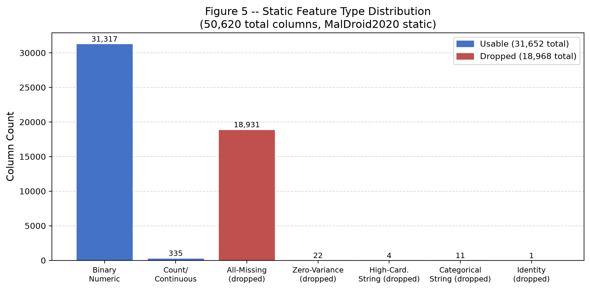
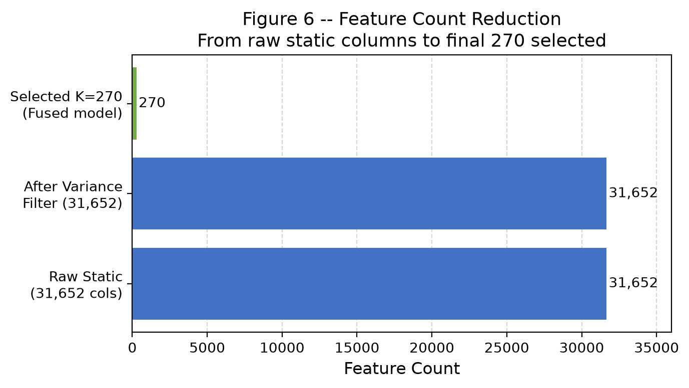
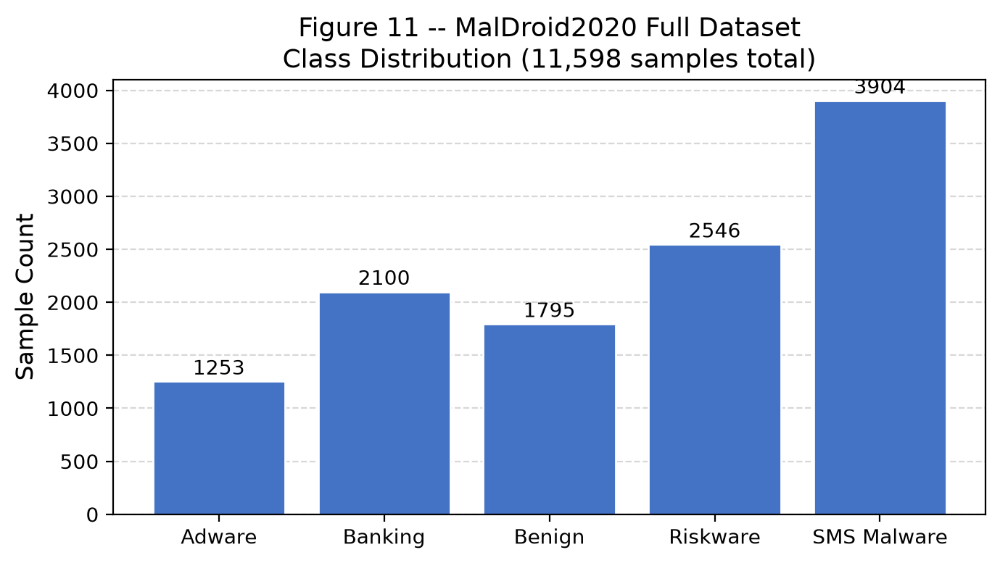
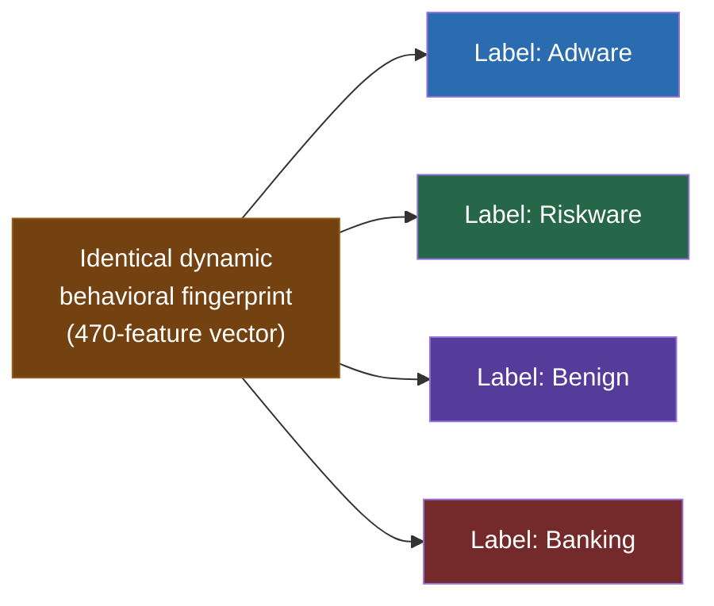

# Dataset Limitations
## Android Malware Classification — Group 3

**Document version:** Final (post-execution)  
**Sources:** `runs/real/reports/stage01_data_audit.json`, `runs/real/reports/stage04_cross_class_duplicate_conflicts.json`

---

## MalDroid2020 Limitations

### 1. Static File Encoding and Alignment

The released MalDroid2020 static feature file (`feature_vectors_static.csv`) requires UTF-7 decoding and column-header realignment before use. Critically, **there is no per-sample SHA-256 hash or APK identifier** in the static feature file. Label attachment was performed via row-order alignment with the dynamic file.

**Impact:** Alignment is empirically verified (matching row counts and per-class distributions) but cannot be cryptographically confirmed. This is a minor provenance limitation and does not materially affect experimental results.

---

### 2. High Dimensionality and Sparsity

The static representation contains 50,620 columns, of which 18,968 (37.5%) are entirely missing and dropped. The remaining 31,652 are predominantly binary (31,317 binary; 335 continuous). This produces a very high-dimensional, sparse representation that requires feature selection.

---

### 3. Class Imbalance

The 5-class distribution is moderately imbalanced:

| Class | Count | % of Total |
|---|:---:|:---:|
| SMS Malware | 3,904 | 33.7% |
| Riskware | 2,546 | 21.9% |
| Banking | 2,100 | 18.1% |
| Benign | 1,795 | 15.5% |
| Adware | 1,253 | 10.8% |

Imbalance ratio (largest : smallest) = 3,904 : 1,253 ≈ 3.1 : 1. Addressed via inverse-frequency class weighting in LightGBM.

---

### 4. Duplicate and Cross-Class Duplicate Records

77 rows in the 139-feature dynamic space and 72 rows in the 470-feature dynamic space are exact duplicates.

**Critical finding — Cross-class dynamic duplicates:** 3 groups of samples share an identical 470-feature dynamic behavioral vector but carry **different ground-truth labels**:

| Group ID | Classes | Samples in Group | Split |
|---|---|:---:|---|
| 5 | Adware, Riskware | 2 | train |
| 776 | Adware, Riskware | 2 | test |
| 1257 | Banking, SMS Malware, Riskware, Benign | 35 | train |

**Impact:** These represent genuine label ambiguity in the feature space — no classifier can resolve identical feature vectors assigned to different classes without additional information. The pipeline keeps each group entirely within one split (no leakage), but this constitutes a performance ceiling for dynamic-only classification. **This is a dataset property, not a pipeline defect.**

All results are reported with this limitation disclosed.

---

### 5. Dataset Scale

11,598 samples is a moderate-scale dataset for a 5-class problem with ~50K-dimensional static features. Generalisation claims should be appropriately bounded. The dataset represents malware families collected at a specific point in time; temporal generalisation is not guaranteed.

---

## AndMal2020 Limitations

### 1. Different Dynamic Instrumentation

AndMal2020's dynamic features (144 columns) are memory, API-count, battery, logcat, and process-count metrics — fundamentally different from MalDroid's syscall/Binder event frequencies. This caused the feature-space incompatibility that prevented external validation of the locked fused model.

See: [`03_EXTERNAL_VALIDATION_ANDMAL.md`](03_EXTERNAL_VALIDATION_ANDMAL.md)

---

### 2. No Benign Dynamic Records

AndMal2020's dynamic dataset contains **malicious application records only**. No benign dynamic measurement files exist in the released version. A balanced 5-class dynamic evaluation population cannot be constructed from AndMal dynamic data alone.

---

### 3. Static/Dynamic Population Alignment

AndMal2020 static files are organized by SHA-256 hash (each row is one application). Dynamic files are categorized by malware family and before/after reboot timing. The exact population of applications with both static and dynamic records is not pre-established. A valid cross-modal fusion study would require a hash-based join across these files, which was not performed in this project.

---

### 4. Label Taxonomy Differences

AndMal2020 uses a more granular taxonomy than MalDroid's 5 classes. The mapping applied is:

| AndMal Category | MalDroid Mapping | Static Rows |
|---|---|:---:|
| Adware | Adware | 47,210 |
| Banker | Banking | 887 |
| SMS | SMS Malware | 3,125 |
| Riskware | Riskware | 97,349 |
| Ben0–Ben4 | Benign | 162,181 |
| Backdoor | ❌ Unmapped | 1,538 |
| Dropper | ❌ Unmapped | 2,302 |
| FileInfector | ❌ Unmapped | 669 |
| NoCategory | ❌ Unmapped | 2,296 |
| PUA | ❌ Unmapped | 2,051 |
| Ransomware | ❌ Unmapped | 6,202 |
| Scareware | ❌ Unmapped | 1,556 |
| Spy | ❌ Unmapped | 3,540 |
| Trojan | ❌ Unmapped | 13,559 |
| Zeroday | ❌ Unmapped | 13,340 |

Unmapped categories are excluded from the 5-class evaluation. Rows mappable: 310,752 of 357,805 total.

---

### 5. Extreme Class Imbalance in Mapped Subset

Within the 5-class compatible static subset, Riskware (97,349 records) dominates over Banker (887 records) — a ratio exceeding **109:1**. Any evaluation on this subset requires careful stratification and imbalance handling.

---

## General Limitations

- **Temporal scope:** Both datasets represent malware from specific collection periods. Classification performance may degrade against malware families emerging after the dataset cutoff.
- **Dataset provenance:** Both are publicly released research datasets. The labeling was not independently verified; the pipeline treats provided labels as ground truth.
- **Feature engineering scope:** Static features are derived from APK analysis; dynamic features from sandbox execution. Apps behaving differently in live vs. sandbox environments may not be fully characterised.

---

*All dataset statistics sourced from `runs/real/reports/stage01_data_audit.json` and `runs/real/reports/stage04_cross_class_duplicate_conflicts.json`.*
