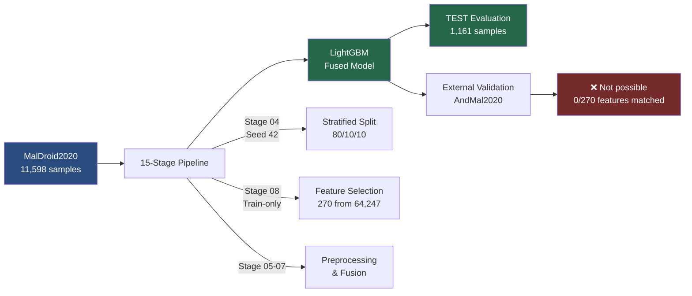
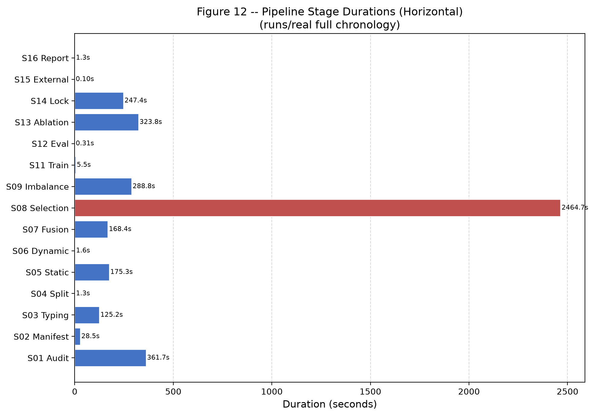
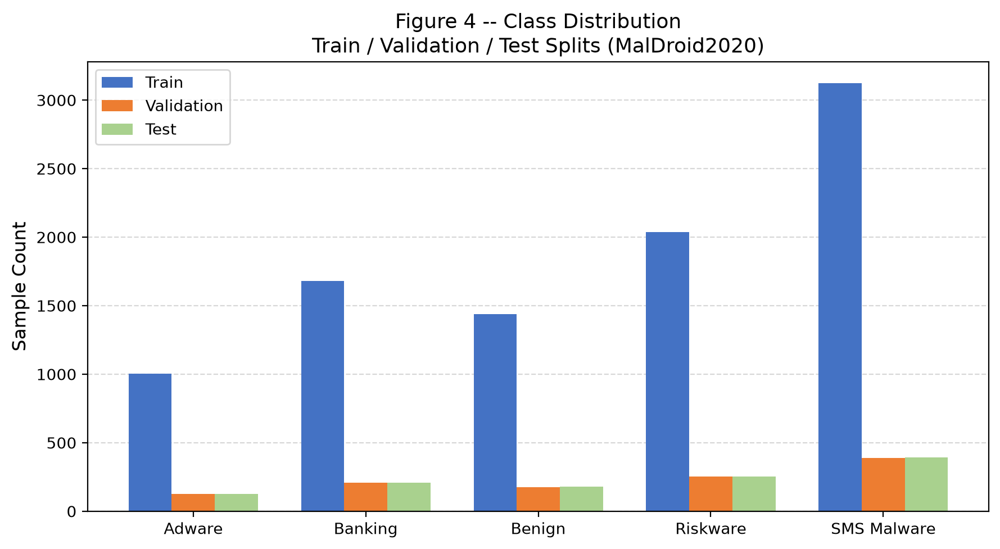
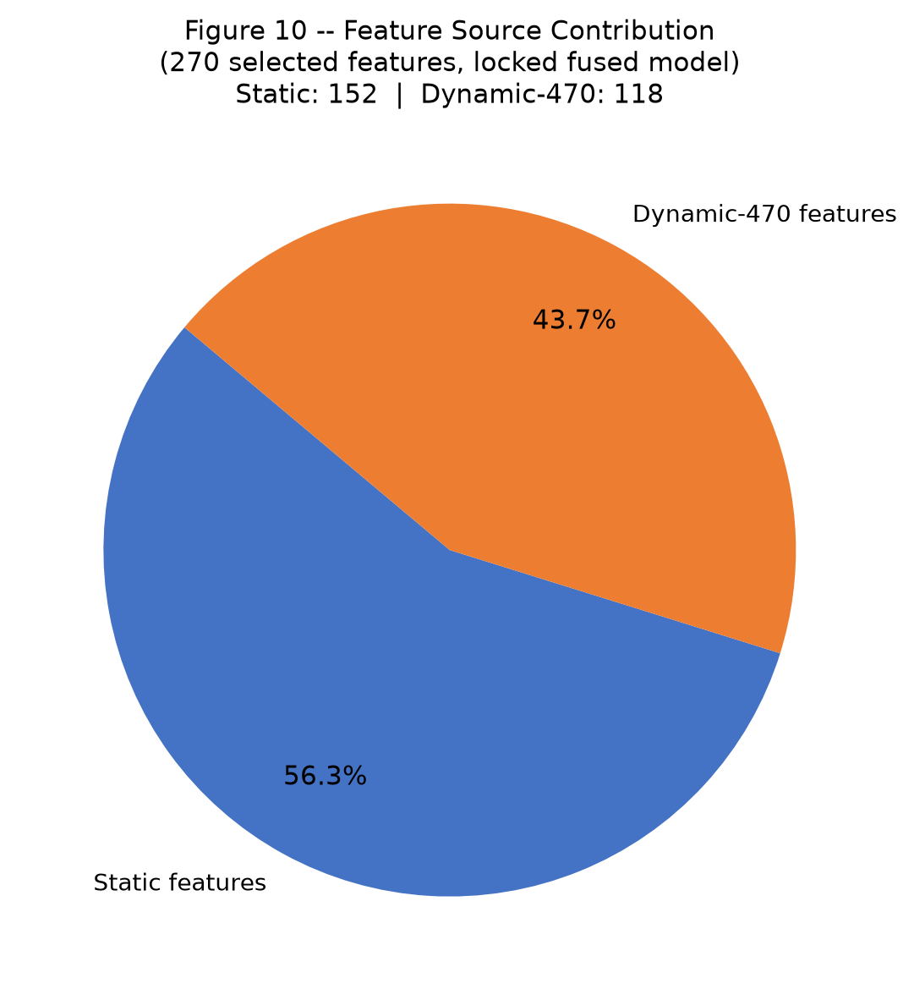
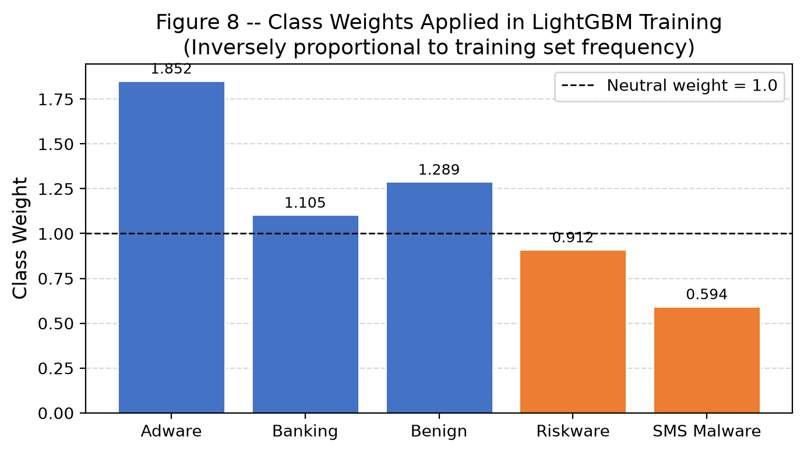
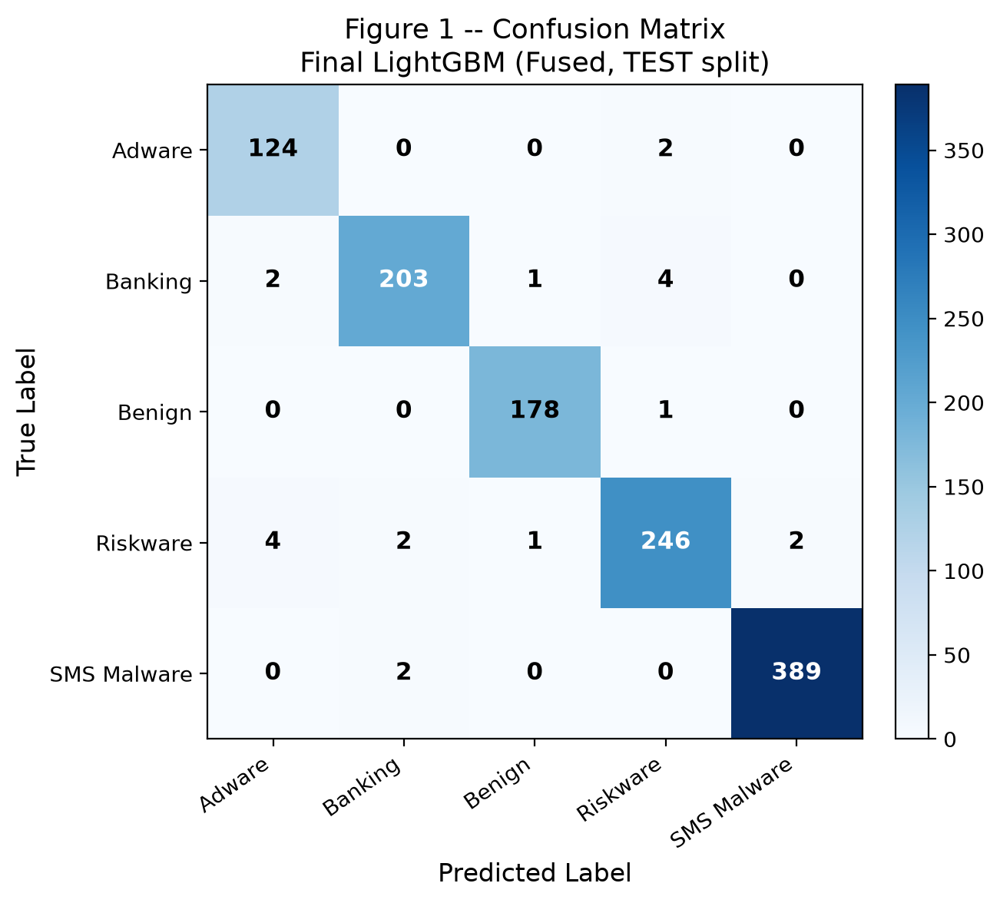
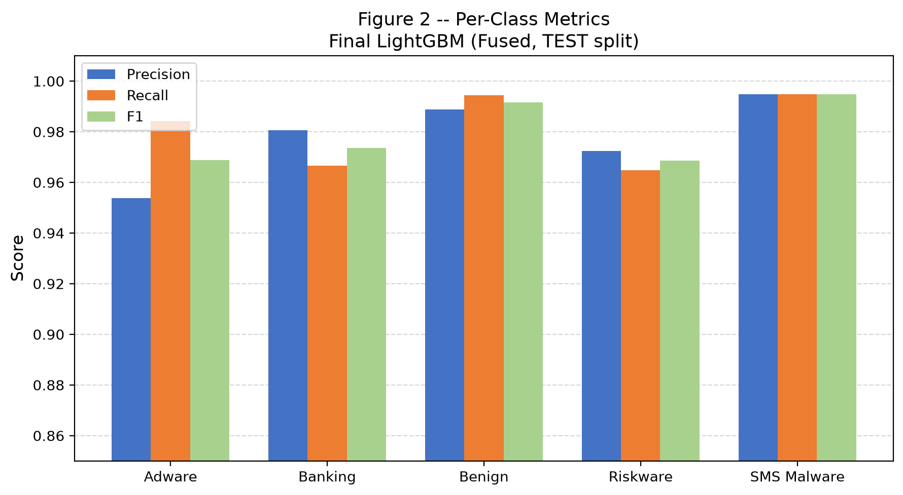
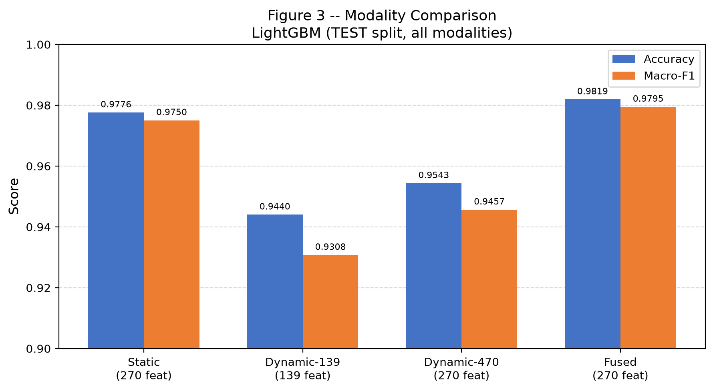
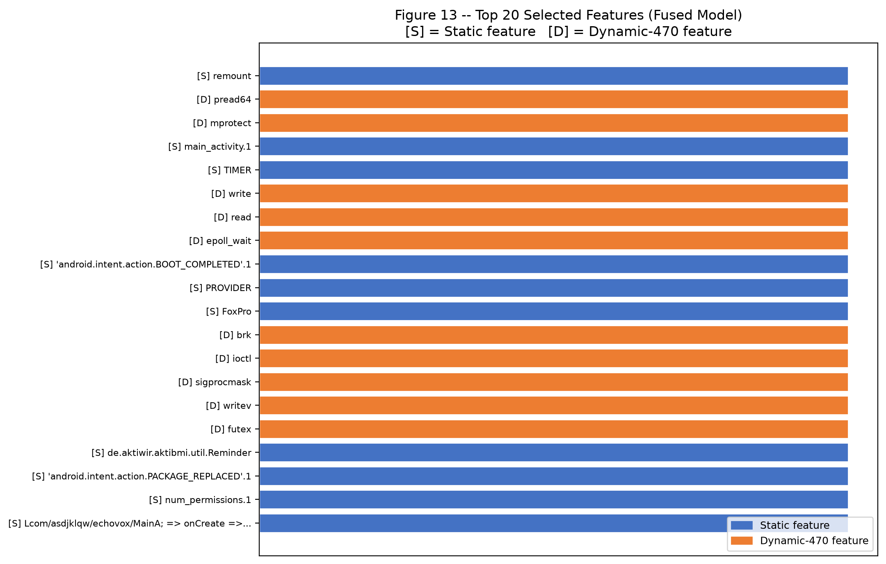

# Final Results Summary
## Android Malware Classification — Group 3

> **This document is designed to be read in 5 minutes.**  
> All numbers are exact values from `runs/real` artifacts. No rounding, no estimation.

---

## A. Dataset Selection

| Dataset | Role | Samples | Classes | Feature Modalities |
|---|---|:---:|:---:|---|
| MalDroid2020 | **Primary** (train / val / test) | 11,598 | 5 | Static (50,620 cols) + Dynamic-139 + Dynamic-470 |
| AndMal2020 | External validation (attempted) | 357,805 static | 5 (mapped) | Static (9,503 cols) + Dynamic (144 cols, malicious only) |

MalDroid2020 was selected as primary because it provides matched static and dynamic feature representations for the same application population, enabling valid cross-modal fusion. AndMal2020 was designated for external generalization analysis.

---

## B. Pipeline Architecture

Total pipeline execution time: **~1.2 hours** (dominated by feature selection: 2,464.7 s)

---

## C. Final Split

| Split | Samples | Adware | Banking | Benign | Riskware | SMS Malware |
|---|:---:|:---:|:---:|:---:|:---:|:---:|
| Train | 9,281 | 1,002 | 1,680 | 1,440 | 2,036 | 3,123 |
| Validation | 1,156 | 125 | 210 | 176 | 255 | 390 |
| Test | 1,161 | 126 | 210 | 179 | 255 | 391 |

Seed 42 · Stratified by label · Duplicate-group guard applied

---

## D. Preprocessing

| Stage | Operation | Fit On | Applied To |
|---|---|---|---|
| Stage 05 | StandardScaler (static, 31,652 cols) | Train only | Train / Val / Test |
| Stage 06 | StandardScaler (dynamic-139, 139 cols) | Train only | Train / Val / Test |
| Stage 06 | StandardScaler (dynamic-470, 470 cols) | Train only | Train / Val / Test |
| Stage 07 | Row-wise concatenation | N/A | All splits |

No test-set information was used in any fitting step.

---

## E. Feature Selection

| Parameter | Value |
|---|---|
| Methods | mutual_info, chi2, lightgbm_importance |
| K values evaluated | 50, 100, 270 |
| Modalities evaluated | static, dynamic_139, dynamic_470, fused |
| **Final K** | **270** |
| **Final modality** | **fused** |
| Static features in contract | 152 |
| Dynamic-470 features in contract | 118 |

---

## F. Final LightGBM Configuration

| Parameter | Value |
|---|---|
| `n_estimators` | 300 |
| `num_leaves` | 31 |
| `learning_rate` | 0.05 |
| `device_type` | `cpu` |
| `random_state` | 42 |
| Class weights | Adware: 1.8525 · Banking: 1.1049 · Benign: 1.2890 · Riskware: 0.9117 · SMS Malware: 0.5944 |

---

## G. Final Test Metrics (TEST split — 1,161 samples)

> **Authoritative result.** Source: `stage14_lock_manifest.json` → `verified_test_metrics`

| Metric | Exact Value |
|---|---|
| **Accuracy** | **0.9819121447028424** |
| **Macro-F1** | **0.9794806809300622** |
| Weighted-F1 | 0.9819083668084967 |
| Balanced Accuracy | 0.9809595702907510 |

### Per-Class Results

| Class | Precision | Recall | F1 | Support |
|---|:---:|:---:|:---:|:---:|
| Adware | 0.9538 | 0.9841 | 0.9688 | 126 |
| Banking | 0.9807 | 0.9667 | 0.9736 | 210 |
| Benign | 0.9889 | 0.9944 | 0.9916 | 179 |
| Riskware | 0.9723 | 0.9647 | 0.9685 | 255 |
| SMS Malware | 0.9949 | 0.9949 | 0.9949 | 391 |

---

## H. Modality Comparison (TEST split)

| Modality | Features | Accuracy | Macro-F1 | Balanced Acc |
|---|:---:|:---:|:---:|:---:|
| Static only | 270 | 0.9776 | 0.9750 | 0.9750 |
| Dynamic-139 | 139 | 0.9440 | 0.9308 | 0.9348 |
| Dynamic-470 | 270 | 0.9543 | 0.9457 | 0.9478 |
| **Fused ⭐** | **270** | **0.9819** | **0.9795** | **0.9810** |

---

## I. Main Feature Findings

- 270 features selected from 64,247 total (fused) columns
- 152 static + 118 dynamic-470 features in the locked contract
- Top discriminative static features: permission flags, intent action indicators, sensitive API call indicators, numeric metadata
- Top discriminative dynamic features: low-level syscall frequencies, Binder/IPC call patterns, network/filesystem access patterns
- Static-only already achieves Macro-F1 = 0.9750, suggesting static features carry the majority of discriminative signal

---

## J. External AndMal Result

| Item | Value |
|---|---|
| Validation possible | **No** |
| Required features | 270 |
| Matched in AndMal | **0** |
| AndMal dynamic columns | 144 |
| Root cause | Different dynamic instrumentation frameworks (syscall/Binder vs. memory/API/battery) |
| Zero-fill attempted | **No** — rejected as scientifically invalid |

**Correct statement:** *"Direct external evaluation of the locked fused MalDroid model on AndMal2020's dynamic feature representation was not valid under the current feature contract."*

---

## K. Reproducibility

| Item | Value |
|---|---|
| Seed | 42 |
| Config | `runs/real/config.yaml.snapshot.json` |
| Environment | `runs/real/environment.json` |
| Frozen model | `runs/real/artifacts/stage14_frozen_model.joblib` |
| Model SHA-256 prefix | `ab63ed065259b79e` |
| Entry point | `python one_run.py` |
| Python | 3.10.20 · LightGBM 4.7.0 · scikit-learn 1.7.2 · Pandas 2.3.3 |

---

## L. Key Limitations

1. **Static alignment:** Row-order based (empirical), not hash-based (no per-sample hash in MalDroid static file)
2. **Cross-class duplicates:** 3 groups share identical dynamic fingerprints across different class labels — genuine performance ceiling
3. **LightGBM CPU only:** GPU Tree Learner unavailable in installed wheel; no GPU timing measured
4. **External validation:** Not executable for locked fused model (feature-space incompatibility)
5. **Temporal scope:** Results bounded to malware families in MalDroid2020 at collection time

---

## M. Final Conclusion

The Group 3 shared data pipeline successfully processes raw MalDroid2020 data through 15 leakage-safe stages, selects 270 discriminative fused features, and trains a LightGBM classifier achieving:

| Metric | Value |
|---|---|
| **Test Accuracy** | **98.19%** (0.9819121447028424) |
| **Test Macro-F1** | **97.95%** (0.9794806809300622) |
| **Test Balanced Accuracy** | **98.10%** (0.9809595702907510) |

on a held-out test set of 1,161 samples across 5 malware/benign classes.

The fused static + dynamic representation outperforms all single-modality variants. Cross-dataset external validation was not possible for the locked fused model and is reported accurately with full explanation. The pipeline, model, preprocessing artifacts, and feature contracts are fully reproducible from seed 42.
