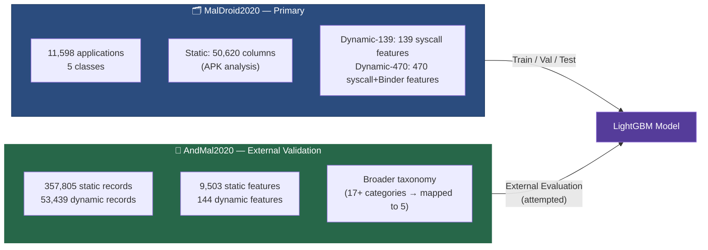
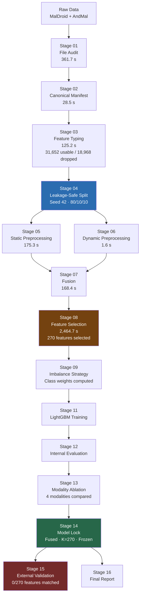
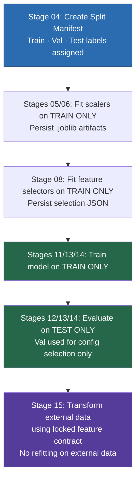
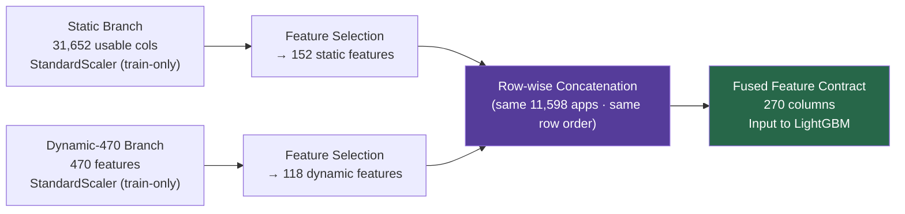
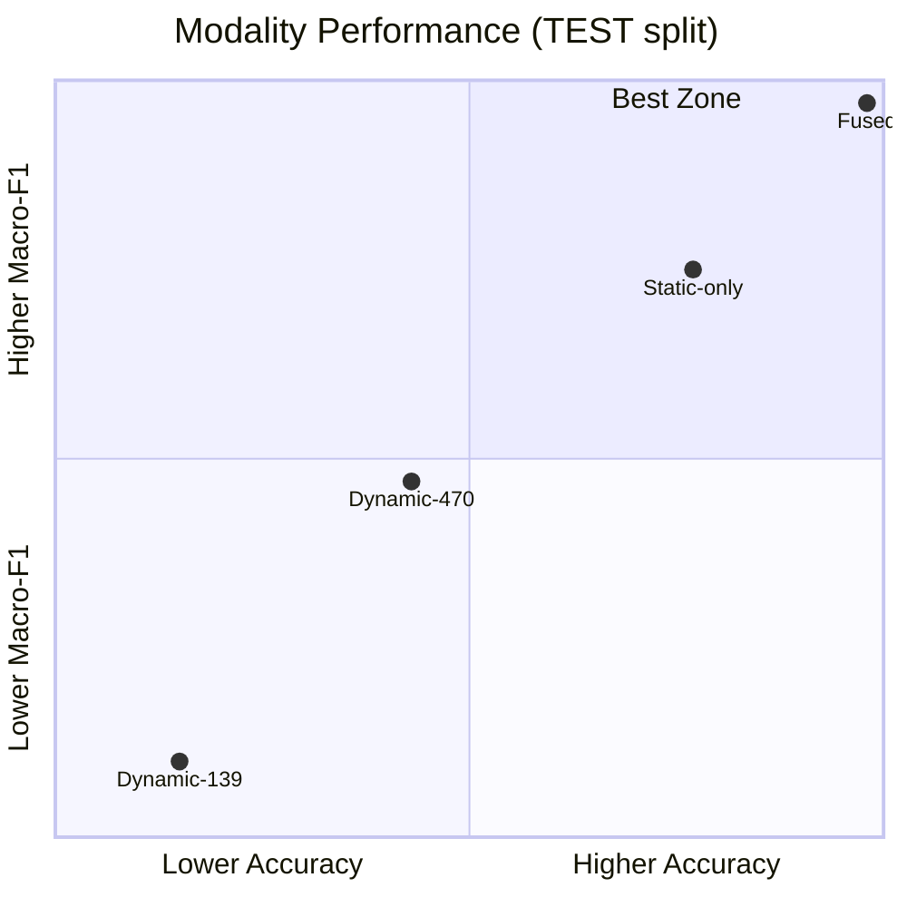
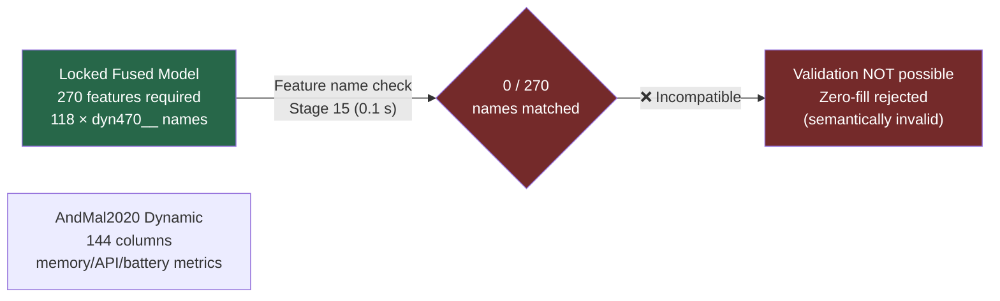

# Presentation Architecture
## Android Malware Classification — Group 3

> **Slide-ready content.** Each `---` section = one slide or slide group.

---

## Slide 1 — Problem Statement

**Android Malware Detection as 5-Class Classification**

- Android malware is a growing threat; automated, scalable detection is required
- Given: static + dynamic features extracted from Android APKs
- Predict: one of 5 categories — Adware · Banking · SMS Malware · Riskware · Benign
- Primary metric: **Macro-F1** (equal weighting across all classes)
- Supporting metrics: Accuracy · Balanced Accuracy

---

## Slide 2 — Dataset Choice

**Why MalDroid as primary?** It provides matched static + dynamic representations for the **same** application population — enabling valid fusion. AndMal2020 is used only for external generalization analysis.

---

## Slide 3 — Why MalDroid Primary

| Property | MalDroid2020 | AndMal2020 |
|---|---|---|
| Samples | 11,598 | 357,805 |
| Static features | 50,620 | 9,503 |
| Dynamic features | 139 / 470 | 144 (malicious only) |
| Static + Dynamic matched? | ✅ Yes (same population) | ⚠️ Not pre-established |
| Per-sample hash in static? | ❌ No | ✅ Yes |
| Dynamic instrumentation | Syscall/Binder traces | Memory/API/battery metrics |
| Role in this project | Primary | External validation |

---

## Slide 4 — Why AndMal External

- Different dynamic instrumentation → feature-space incompatible with MalDroid model
- No benign dynamic records in the released dataset
- Static/dynamic populations not pre-aligned for fusion
- Broader taxonomy needs mapping → some categories unmappable

**Used for:** post-hoc generalization check after model is finalized on MalDroid.  
**NOT used for:** tuning, training, preprocessing decisions, or feature selection.

---

## Slide 5 — Pipeline Overview

---

## Slide 6 — Leakage Prevention

**Key guarantee:** No test-set information informed any fitting step (preprocessing, selection, or training).

---

## Slide 7 — Feature Engineering

### Static Features (50,620 → 31,652 usable → 152 selected)

### Feature Selection: 3 Methods × 3 K-Values × 4 Modalities

| Method | Description |
|---|---|
| Mutual Information | Information-theoretic dependence with label |
| Chi-Squared | Statistical feature-label dependence |
| LightGBM Importance | Tree split-gain scores (train-only) |

---

## Slide 8 — Feature Selection Result

**Final contract:** 270 features = 152 static + 118 dynamic-470

---

## Slide 9 — Fusion

**Validity:** Fusion is valid because MalDroid static and dynamic files share the same 11,598 applications in the same row order.

---

## Slide 10 — LightGBM Model

| Parameter | Value |
|---|---|
| Algorithm | Gradient Boosted Trees (histogram-based) |
| `n_estimators` | 300 |
| `num_leaves` | 31 |
| `learning_rate` | 0.05 |
| `device_type` | CPU |
| `class_weight` | Inverse-frequency (computed from training set) |
| Seed | 42 |
| Training time | 11.49 seconds |

**Why LightGBM?** Handles sparse binary features natively · Fast on high-dimensional data · Built-in class weighting · No normalization required · Multi-class softmax support

---

## Slide 11 — Results

| Modality | Accuracy | Macro-F1 |
|---|:---:|:---:|
| Dynamic-139 | 0.9440 | 0.9308 |
| Dynamic-470 | 0.9543 | 0.9457 |
| Static-only | 0.9776 | 0.9750 |
| **Fused ⭐** | **0.9819** | **0.9795** |

---

## Slide 12 — Final Test Results

**1,140 / 1,161 correctly classified on held-out test set**

---

## Slide 13 — External Validation Limitation

**Root cause:** MalDroid dynamic = syscall/Binder traces · AndMal dynamic = memory/API/battery monitoring — completely different instrumentation frameworks.

**Correct interpretation:** Feature-space incompatibility for THIS locked fused model. Not a model failure. Not a dataset failure.

---

## Slide 14 — Key Findings

| Finding | Detail |
|---|---|
| ✅ Fused modality wins | Macro-F1 = 0.9795 vs. Static-only 0.9750 |
| ✅ Static > Dynamic alone | Static-only outperforms both dynamic-only variants |
| ✅ Fast training | 11.49 s retrain on CPU (11,598 samples, 270 features) |
| ✅ Strong per-class F1 | Worst class: Adware F1 = 0.9688 |
| ⚠️ Cross-class duplicates | 3 groups — genuine label ambiguity in dynamic space |
| ❌ External validation | Feature-space incompatible; not performed |

---

## Slide 15 — Limitations

1. **Static alignment:** Empirical row-order matching (no per-sample hash in MalDroid static file)
2. **Cross-class dynamic duplicates:** 3 groups with identical feature vectors but different labels — performance ceiling
3. **LightGBM CPU only:** GPU Tree Learner unavailable in the installed wheel
4. **External validation:** Not possible for locked fused model (feature-space incompatibility)
5. **Temporal scope:** Results bounded to MalDroid2020 collection period

---

## Rendered Architecture Diagrams

All Mermaid diagrams above render natively in:
- GitHub Markdown previews
- VS Code with Mermaid extension
- Any Mermaid-compatible documentation system

Source `.mmd` files are in [`diagrams/`](diagrams/).

---

*Content sourced entirely from `runs/real` execution artifacts. All metric values are exact.*
